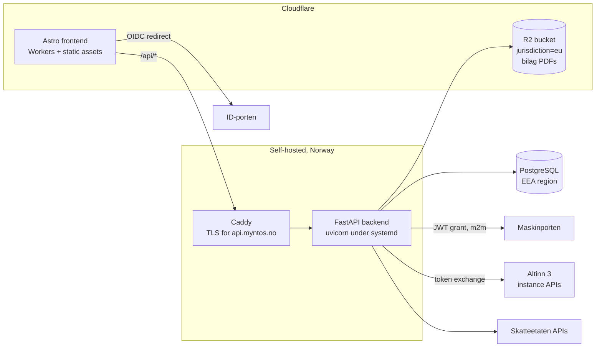

# Architecture

> Facts below about Skatteetaten/Digdir/Cloudflare were researched and
> verified against official sources in July 2026. Re-verify anything
> load-bearing before implementing against it — government APIs move.

## System overview



## Accounts, organizations and login

Myntos has its own accounts, entirely separate from the government auth below.
A user signs in with **email and password** or with **Google** ("logg inn med
Gmail"); both land in the same account model.

### The company is the tenant; the account only owns companies

```
Organization ─── OrganizationMembership ── User ─┬─ password hash
  (an account)      (may add companies)          ├─ UserIdentity (google)
        │                                        │
        └─ Company (orgnr) ─┬─ CompanyMembership ┘  (role, access, per company)
              (plan)        └─ ledger, bilag, MVA
```

**This changed on 2026-09-03, and the shape above is the point.** Access used to
be account-wide: one membership row let a person into every set of books on the
account. That is right for a sole trader with one company and wrong for
everybody else. A regnskapsfører keeps one company per client, and "help me with
this client" was not expressible; worse, the invitation form sat under the
account, so what it actually granted was invisible. See
[company-isolation.md](company-isolation.md).

- **`Company`** is a bookkeeping-obligated entity with an orgnr, and it is the
  unit of access, of billing (`plan`) and of everything a person looks at. A
  regnskapsfører is one account with many companies and a different set of
  colleagues on each; a single AS is one account with one company. `orgnr` is
  unique *per organization*, not globally, so two accounting firms can each keep
  a set of books for the same client. A **confirmed** claim on an orgnr is the
  one thing that is globally unique (see below). Everything the row says about
  the entity itself comes from Enhetsregisteret rather than from a form.
- **`CompanyMembership`** is what grants access: one row per person per company,
  carrying the role. Roles are `owner`, `admin`, `member`, `viewer`, and the
  role → permission table lives in exactly one place
  (`domain/identity/access.py`) — no endpoint compares roles itself. Two rules
  are load-bearing: only an owner may create, demote or remove an owner (else
  the owner/admin split is decorative), and the last owner may not leave (books
  nobody owns can be neither billed nor shared). The same person can own their
  own books and merely read a client's.
- **`Organization`** is the account somebody signs up for. It answers two
  questions and no others: which companies were set up together, and who may add
  another one (`organization:manage` on `OrganizationMembership`). **Nothing
  displays its name**, and no rule may ever copy a company's name onto it: an
  account is routinely called after its first company, and such a name printed
  near a *different* company is indistinguishable from a leak. It was reported
  as one. See migration `c4d7e81f2a90`.
- Somebody invited to a company gets **that company and nothing else**: no
  membership of the sender's account, no sight of its other clients, and no way
  to add companies to it.
- Colleagues join through an **invitation** addressed to an email address, which
  names the company it is for. Only
  the token's hash is stored, it is single-use, and the accepting account's
  address must match the invited one — a forwarded link is not a ticket in.
  An invitation may also carry the **name** of the person it is meant for, which
  is a label and never a check: it greets them in the email and lets the
  company's board list show that they have been asked. Because the token cannot
  be recovered, re-sending issues a new one on the same row and kills the old
  link, rather than making the inviter revoke and retype the address.
- **`UserGovernmentIdentity`** records which person is behind an account, as
  ID-porten asserted it. Written by the ID-porten callback and by nothing else,
  after the assurance-level check. Deliberately not the same row as the
  short-lived `GovernmentLoginAttempt`: an authorization expires within the
  hour, and who somebody is does not. It is what lets the board list in
  Enhetsregisteret say which registered role holders can open the books. See
  [register-access.md](register-access.md).

### Confirmed ownership

Creating a company proves nothing: anyone can type nine digits into a form. So a
set of books starts **unconfirmed**, and `POST /api/v1/companies/{id}/bekreft`
is what turns it into a claim — the caller's ID-porten login is spent on
Altinn's own list of parties they may act for
(`integrations/altinn/authorized_parties.py`), and only an orgnr on that list
may be confirmed. It is the same evidence a submission later rests on, which is
the point: the confirmation is not a second, weaker check of our own invention.

Three columns record it (`verified_at`, `verified_by_user_id`,
`altinn_party_id`) and one index enforces it:

```sql
CREATE UNIQUE INDEX uq_company_verified_orgnr ON company (orgnr)
  WHERE verified_at IS NOT NULL
```

**One confirmed claim per orgnr across the installation, and unconfirmed rows
left alone.** Both halves are load-bearing and they pull in opposite directions.
Without the exclusivity, "this company already has a regnskap registered" could
never be said, and two organizations would each believe they were the ones
filing. Without the permissiveness, a regnskapsfører could not keep books for a
client whose own confirmation sits elsewhere — which is most clients. The domain
checks the rule first and answers with prose (`CompanyAlreadyClaimedError` →
409 `company_already_claimed`); the index is what makes two confirmations
racing produce one winner rather than two.

The refusal names the two ways forward — ask an administrator there for access,
or keep unconfirmed books of your own — and deliberately does **not** name the
organization holding the claim, which the caller is not a member of. For the
same reason `GET /skatt/altinn/authorized-parties` marks each party `claimed`
rather than saying by whom: it answers only for orgnrs Altinn has already said
the caller may act for, so the flag discloses nothing they could not learn by
trying, and it puts the conflict where the choice is made instead of after a
save that fails.

Nothing is gated on it. An unconfirmed company books, invoices and reports
exactly like a confirmed one — bookkeeping does not wait for BankID on a Sunday
evening. What the confirmation settles is *whose* company it is. Until it is
settled, the header carries a small red dot beside the company name and
`/organisasjon/` opens with a yellow banner and a **Bekreft nå** button. The dot
says only "look here"; the banner says the rest, at full size, where the button
that fixes it is.

### What comes from Enhetsregisteret

The register is asked for everything it has, not for a name and an address.
Every field left out is a field somebody types instead, and typing is where a
set of books ends up describing a subtly different entity.

`GET /api/v1/enhetsregisteret/{orgnr}` returns the whole entry — organisasjonsform,
business and postal addresses with kommune, næringskoder, contact details,
stiftelses- and registreringsdatoer, employee count, sector code, share capital,
vedtektsfestet formål, former names, konkurs/avvikling markings, and, for a
subunit, the `overordnetEnhet` it belongs to.
`GET /api/v1/enhetsregisteret/{orgnr}/roller` returns who holds a registered
role: styre with its leder, medlemmer and varamedlemmer, daglig leder, innehaver,
revisor, regnskapsfører, forretningsfører, bostyrer, kontaktperson. Roles live on
the main unit only — `/underenheter/{orgnr}/roller` is a 404 — so a subunit's are
read from its parent.

Two things are dropped on the way through, both deliberately. The register pairs
every person with a **birth date**; it never reaches a browser, for the reason
fødselsnummer never reaches one from the Altinn party list. And a role the
register has ended is filtered out rather than shown greyed: the list answers
"who may act for this company today", and a former daglig leder in it is a wrong
answer, not a historical note.

A small subset is **stored** on the company — `industry_code`,
`industry_description`, `website`, `phone`, `email`, `parent_orgnr`, alongside
the address and registration flags that were already there — because something
in the system uses each of them: the næringskode for a næringsspesifikasjon, the
contact details for a salgsdokument. `register_synced_at` is what makes that a
cache rather than a second opinion. The rest is fetched live for display and
never persisted: it changes without telling us, and some of it is other people's
personal data.

`POST /api/v1/companies/{id}/hent` re-reads it and **answers with the list of
fields that moved**. A refresh that silently rewrote the VAT flag would change
what every future invoice claims without anyone being told. Two rules keep it
honest: a null from the register means "we never had this", not "delete what you
stored"; and the **name is never overwritten**, because a name somebody edited
on purpose and one that has gone stale are indistinguishable from the server —
the register's name is shown beside the stored one instead.

The refresh also runs by itself when a company is created and when one is
confirmed, both best-effort. Brønnøysund being slow must not turn a completed
signup into an error page.

### Where the organization's name comes from

Signup does not ask for one. People who are not accountants do not think of
themselves as having an "organization", and a required field there is a wall in
front of the first screen. So signup invents `"Kari Nordmann (privat)"` and sets
**`organization.name_is_placeholder`**.

That flag is stored rather than recomputed, because it cannot be recomputed: the
user may have changed their own name since, and comparing the current name
against the generated string would guess wrong for exactly those people.

**An account is never named after one of its companies.** It was, until
2026-09-03: `POST /api/v1/companies` called
`identity.service.adopt_name_if_placeholder`, so setting up the first set of
books renamed a placeholder organization to that company's name. The intent was
a header that did not say "Kari Nordmann (privat)" next to an orgnr looked up
from Enhetsregisteret.

The header stopped showing the organization's name long before that mattered,
and the cost outlived the benefit: an account called after one of its own
companies is indistinguishable, on screen, from one company's data appearing
under another company's name. With two companies on the account, the settings
page said `Lindeman Technologies` on the account card while the header said
`DIALGA AS`, and it was reported as a leak. The function is gone, migration
`c4d7e81f2a90` gave the borrowed names back, and
[company-isolation.md](company-isolation.md#accounts-are-never-named-after-companies)
is the rule not to reintroduce it.

So a placeholder name stays until somebody chooses one. `PATCH
/api/v1/organizations/{id}` is the only thing that clears the flag.

Both `GET /auth/me` (as `organization_name_is_placeholder`) and the organization
endpoints (as `name_is_placeholder`) expose it, so the frontend can offer a
rename instead of presenting a made-up name as settled fact.

### Credentials and sessions

- The **password hash** (Argon2id) sits on the user; each **federated login** is
  a separate `user_identity` row. One person can hold both, so someone who
  signed up with a password and later clicks "log in with Google" keeps the same
  account, memberships and audit trail instead of forking a second one.
- A federated identity is only linked to an **existing** account when the
  provider asserts the email is **verified**. Matching on the address alone is
  the classic federated-login account-takeover — Microsoft's nOAuth advisory is
  the same bug — and refusing is the whole defence. A *new* account is created
  either way, because there is nobody to take over and refusing would block
  every Microsoft user (see below); it is simply recorded as unverified.
- **Sessions are server-side and revocable**: an opaque 256-bit token in an
  `httpOnly; Secure; SameSite=Lax` cookie, stored only as a SHA-256 digest. A
  stateless JWT was rejected because "log me out everywhere" and "lock this
  compromised account" have to take effect immediately on a system holding
  accounting records. Non-browser clients can ask for the same token as a bearer
  token instead.
- Cookie-authenticated **writes** additionally require an `Origin` in the CORS
  allow-list, as a second layer behind `SameSite`. Bearer-authenticated requests
  skip the check — the header has to be attached deliberately.

**Email** is one message and two transports: the invitation, composed in
`domain/identity/invitation_mail.py` and sent inline by the endpoint that
creates the invitation, so the response can say whether it went. The Myntos mark
travels inside the message as a related MIME part (`core/brand.py`), never as a
URL: a remote logo is a blocked image in most clients and a read receipt in the
rest, and the word "Myntos" sits beside it as text so a blocked one still names
the sender. `core/mail.py`
holds both transports, SMTP (`SMTP_HOST`) and Cloudflare Email Sending
(`CLOUDFLARE_ACCOUNT_ID` + `CLOUDFLARE_EMAIL_TOKEN`), and `MAIL_FROM` decides
the sender for either. Both put the same bytes on the wire: `build_message`
composes the MIME message once and Cloudflare's `send_raw` endpoint takes it as
composed, so the transport never changes what a recipient reads. A deployment
that configures neither is a supported deployment: nothing is sent, the
interface says so, and the invite link is returned to the inviter once, to pass
on by hand. A refused relay, an unreachable API and a permanent bounce are all
reported the same way and never roll back the invitation, which already exists.

This deployment sends through Cloudflare, on `myntos.no`, whose SPF, DKIM and
DMARC records `wrangler email sending enable` wrote and maintains.

Not yet built, and deliberately: no address-verification mail and no password
reset.

### Federated providers

One OIDC implementation (`auth/oidc/client.py`), several providers as data
(`auth/oidc/providers.py`): authorization-code flow with PKCE, `state` and
`nonce` in an `oauth_login_attempt` row, and full ID-token verification.
`/auth/{provider}/start` and `/auth/{provider}/callback` are generic, and
`/auth/providers` lists only what this deployment has credentials for — so a
button can never lead to a 503. Adding a provider needs no migration:
`user_identity.provider` is a VARCHAR precisely so the list can grow.

Three things genuinely differ between providers, and each has bitten real
systems:

| | Google | Microsoft (Entra ID) | Vipps |
| --- | --- | --- | --- |
| Issuer check | two accepted spellings | discovery returns a `{tenantid}` **template**, resolved against the token's own `tid` (validated as a GUID first) | plain equality |
| Email verified | `email_verified` | **not sent** — `xms_edov` optional claim instead | `email_verified` |
| Email claim | `email` | `email`, falling back to `preferred_username` | `email` |

The Microsoft row is the interesting one. Entra ID never emits
`email_verified`; the equivalent is `xms_edov` ("email domain owner verified"),
an optional claim that has to be switched on in the app registration and that
exists as Microsoft's own remediation for nOAuth. Absence therefore reads as
*unverified* — which stops a Microsoft login from being attached to an existing
Myntos account, without preventing a new one. `MICROSOFT_TENANT` is an
authorization boundary rather than a formality: `common` lets any Microsoft
tenant in the world start a sign-in.

Vipps needs a merchant agreement rather than a self-service app registration,
and its discovery URL in `.env.example` has **not** been verified against
current Vipps documentation — check it before enabling. It is a configuration
value, so correcting it is not a code change.

## The cash-flow register

The first thing a user can actually do. One payment in or out per entry, and
three questions: how much moved, when, and **what it was for**.

That third one is the whole design. A bank statement cannot tell a deductible
cost from a private withdrawal, and the difference is exactly what the
næringsspesifikasjon and the MVA-melding are built from. So the register asks,
with a catalogue of types (`domain/ledger/cashflow.py`) that each carry:

- the **account** the amount books to — and through that account, the per-year
  `GroupingCategory`/`GroupingCode` that becomes a skattemelding post;
- the **default VAT code**, which is what the MVA-melding aggregates over; and
- a **note stating the assumption**, because the default is a default. Rented
  premises carry VAT only if the landlord is voluntarily registered, a car
  expense is deductible for a van and not for a passenger car. The user can
  override the code, and the note is shown next to the choice. Guessing
  silently is what turns a bookkeeping tool into a liability.

Mechanically an entry is an ordinary voucher, not a parallel structure:

```
Salg 1 250 kr, 25 % mva                 Kontorrekvisita 625 kr, 25 % mva
  1920 Bank        D 1250                 6800 Kontorrekvisita  D  500  ← mva-kode her
  3000 Salg        K 1000  ← mva-kode her 2710 Inngående mva    D  125
  2700 Utgående mva K  250                1920 Bank             K  625
```

- The user enters the **gross** amount, because that is the number on the bank
  statement. `posting.split_gross` derives the net as `gross / (1 + rate)` and
  the VAT as `gross - net` — never `net * rate`, which rounds the two halves
  independently and leaves vouchers an øre out of balance.
- `TaxInformation` goes on the **basis** line, never the VAT-account line
  (`posting.set_tax_information` is the single writer, so the two callers
  cannot drift).
- Entries are **posted immediately** — the money has moved, there is nothing
  provisional about it — and are therefore immutable. A mistake is undone by
  reversal, and `gl_transaction.reverses_transaction_pk` records which entry
  was undone so an auditor can see both, and so nothing is reversed twice.
- **Every voucher records who entered it**
  (`gl_transaction.created_by_user_id`), because access is a row per person per
  company and a journal is therefore frequently written by more than one hand.
  `system_entry_date` said when the system recorded an entry and nothing about
  by whom, which is fine for a sole trader and useless the moment a
  regnskapsfører and the owner are posting into the same journal. A reversal
  and a correction record **whoever performed them**, not whoever made the
  entry being fixed: those are different people often enough that copying would
  misattribute the one action a reader most wants attributed.
  The column is nullable and stays that way — rows predating it, GDPR erasure
  taking the person and leaving the record (`ondelete="SET NULL"`, since a
  posted voucher outlives every account), and any future job that posts with
  nobody logged in. Not a SAF-T field: the standard's `Transaction` has no user
  element, so it does not reach the export. The register shows the mark only
  when a set of books has more than one author (`frontend/src/lib/authors.ts`).
- Creating a company **seeds** a starter kontoplan, the VAT codes with
  date-effective rates, the first financial year and its per-year account
  groupings. Without that, a new user's first action would be building a chart
  of accounts. Dates before the first financial year are refused: the seeded
  rates are only claimed to hold from then, and posting earlier would snapshot
  an invented rate onto the entry.

**Who** the payment was with is a separate field: `Party`, SAF-T's `Customers`
and `Suppliers`. It is optional, because most payments have no counterparty
worth registering and demanding one makes people invent placeholder suppliers.
Each party settles against a balance account derived from its type
(kundefordringer or leverandørgjeld — SAF-T's `BalanceAccountStructure`), and
the reference goes on the **basis** line, like the tax information, because
that is the line describing the trade. The party number and type are fixed once
created: posted vouchers point at them, and SAF-T exports them per financial
year, so changing either would rewrite what past filings said.

**Bilag documents** attach to a posted voucher (`bilag_attachment` +
`myntos.storage`). PDF only, verified by magic number rather than by the
uploader's `Content-Type`; the storage key is generated and never derived from
the filename; the SHA-256 is stored so the file handed to an auditor can be
proven to be the one uploaded. The archive is **append-only** — there is no
delete endpoint, because bokføringsloven § 13 requires primary documentation to
stay available for five years after the financial year ends.

None of this is a shortcut around the exporters. The register writes the same
tables the SAF-T export and the MVA-melding will read, which is why it was
worth building on the ledger rather than beside it.

### Document storage

Two backends behind one `DocumentStorage` protocol, and one key format shared
by both, so a document moved between them keeps its key. The key is generated
(`yyyy/<uuid>.pdf`) and validated on the way back out: nothing the uploader
supplies takes part in building a path, and a key that cannot express a
traversal cannot be talked into one.

- **local** — filesystem, development only. The production host writes only to
  the unit's `ReadWritePaths`, and nothing is backed up from there.
- **r2** — Cloudflare R2 over its S3 API, signed with SigV4. The
  **jurisdiction is part of the endpoint hostname**
  (`<account>.eu.r2.cloudflarestorage.com`), fixed when the bucket is created
  and unchangeable afterwards, so pointing at the plain hostname does not fail
  over — it silently writes accounting records outside the EEA.
  `R2_JURISDICTION` therefore defaults to `eu` and has to be turned off
  deliberately. Missing or blank credentials fail at startup rather than at the
  first upload.

SigV4 is implemented in `storage/sigv4.py` against httpx rather than pulling in
boto3: botocore is tens of megabytes of vendored service definitions and a
synchronous transport, for about two hundred lines of use. The algorithm is
published and fixed, the implementation is verified against AWS's own
`get-vanilla` test vector, and the failure mode is benign — a signing mistake
means R2 answers 403 on the first request rather than corrupting anything.

## Frontend

Astro, prerendered, no framework. The API lives on its own origin, so every
page talks to it with `fetch(..., {credentials: 'include'})`; the session cookie
is httpOnly, so no script on the page can read it — an XSS bug cannot exfiltrate
a login.

The front page is two pages in one file. What ships in the HTML is the
signed-out one: that is what a search engine indexes and what a visitor without
JavaScript sees. `data-auth` on `<html>` decides which half is displayed, and it
starts at `"ut"`. To avoid a returning user seeing the marketing page flash
before their dashboard, an inline script in `<head>` reads a **hint** from
`localStorage` before first paint. The hint is not a credential and grants
nothing — `/auth/me` answers a moment later and overrules it either way.

The header is **company-first**: the company's name is the loud half and the
signed-in person is the quiet line beneath it, because every page in the
application is about a set of books rather than about an account — a
regnskapsfører switching client has to see *which* client at a glance, while
their own name never changes. The whole name is the link to `/organisasjon/`,
because that is where a company is switched, corrected and confirmed, and it is
what somebody points at when they think "this company". A **red dot** beside it
means nobody has confirmed the ownership yet; the sentence explaining that lives
in the banner the dot leads to, rather than being read again on every page.
`lib/company.ts` holds the one `/companies` request the header and the page
below it share.

The signed-in nav is deliberately three links — Oversikt, Faktura, KI — plus a
cog. It is not a table of contents: `/kontantstrom/` is reached from the
overview, beside the numbers that send you there, and `/parter/` from the
invoice and the cashflow entry, where a customer is actually needed. A link
present everywhere is no easier to find than one present where you are.

| Page | Purpose |
| --- | --- |
| `/` | Marketing when signed out; overview, totals and recent entries when signed in |
| `/kontantstrom/` | The register: entry form, listing, reversal, bilag upload (several files at once, PDF or photograph, with a box for what the documents do not say) |
| `/faktura/` | Salgsdokument: line editor, a review step that shows the § 5-1 findings before anything is issued, kreditnota, PDF and EHF download |
| `/logg-inn/`, `/registrer/` | Password and Google sign-in; the Google button hides itself when the deployment has no Google client |
| `/invitasjon/` | Accepts an invitation token, sending the recipient to sign in first if needed |
| `/organisasjon/` | Everything about **one company**: its own details (the only place its bank accounts, VAT registration, Foretaksregisteret and the address are edited), its subscription, who may open it and who has been invited to it, the Altinn confirmation of who it belongs to, and everything Enhetsregisteret holds about it including the board and the revisor. The board list marks who can open the books and offers to invite whoever cannot: [register-access.md](register-access.md). No account is shown here: see [company-isolation.md](company-isolation.md#the-account-is-not-a-company) |

`/faktura/` is three cards and one of them at a time — the form, the review,
and what came out. Issuing is irreversible, so the step between the form and a
number in an unbroken series is something you **read**: it shows the fields the
buyer is about to receive, the account the invoice is paid to, and every § 5-1
finding, with the issue button disabled while any of them blocks. There is no
separate "save draft" button; submitting the form saves the draft, because the
checks run against the *stored* document. Once issued, the PDF and the EHF are
linked from that same card rather than only from the table below.

Conventions the pages rely on — and the traps that go with them — are in
[docs/frontend-conventions.md](frontend-conventions.md). The load-bearing one:
**visibility is the `hidden` attribute**, and `BaseLayout.astro` has to declare
`[hidden] { display: none !important }` for that to hold, because the browser's
own rule for `hidden` is user-agent origin and loses to any author `display`.

`PUBLIC_API_BASE_URL` is inlined at build time (`frontend/.env.example`). In
production the API must sit on the same registrable domain as the site (e.g.
`api.myntos.no` beside `myntos.no`) so the `SameSite=Lax` cookie is sent, with
a matching `SESSION_COOKIE_DOMAIN` and the site's origin in `CORS_ORIGINS`.

## The two auth planes (this is the part everyone gets wrong)

Skatteetaten's policy as of 2026:

| Operation | Auth required |
| --- | --- |
| Retrieve current skattemelding, PDFs, information APIs | **Maskinporten** (machine-to-machine JWT grant) |
| **Validate + submit** MVA-melding and skattemelding | **ID-porten** (a real person logs in, OIDC authorization-code) |

A fully headless "accounting robot" that submits filings without a human is
**not permitted** — this is a policy wall, not a technical one. Both token
types are exchanged for an **Altinn token**
(`platform.altinn.no/authentication/api/v1/exchange/{maskinporten|id-porten}`)
before calling the Altinn 3 instance APIs that carry the actual submission.

Consequences for the code:

- `auth/maskinporten/` — m2m token provider (JWT grant, RFC 7523). The
  protocol details and sharp edges live in
  [integrations/maskinporten.md](integrations/maskinporten.md).
- `auth/idporten/` — end-user OIDC flow: frontend redirect → backend
  callback → token exchange. Needed before any submission milestone.
- The domain layer never sees tokens; integrations receive a
  `TokenProvider` and handle exchange internally.

## Backend layout (`backend/src/myntos/`)

| Package | Responsibility | Depends on |
| --- | --- | --- |
| `api` | HTTP endpoints, versioned (`/api/v1`) | domain, core |
| `core` | Settings (pydantic-settings, env-driven), security middleware, clock | — |
| `auth` | Myntos login (passwords, tokens, sessions, Google OIDC) **and** Maskinporten + ID-porten token acquisition | core, domain.identity |
| `domain` | Ledger (incl. the cash-flow register), bilag, mva, identity (accounts/organizations) — business logic | core, db |
| `integrations` | Skatteetaten/Altinn/Brreg/Løynd clients (translate domain ⇄ external APIs) | auth, core |
| `saft` | SAF-T Financial export (serializer over the ledger) | domain |
| `db` | SQLAlchemy base/session; Alembic in `backend/migrations/` | core |
| `storage` | Bilag document storage (local dev / R2 prod) | core |

Dependency rule: **`domain` imports nothing from `api`, `integrations` or
`storage`.** Integration code contains no business logic.

### KI: anywhere in the product, one provider only

**The rule: Myntos may use AI wherever it earns its place — but only through
[Løynd](https://loynd.no).** No other model provider, no other endpoint, no
"just for this one feature". A new AI feature needs no architectural argument
about *whether* to use a model; it needs `integrations/loynd.py` and nothing
else. If a task cannot be done through Løynd, it is not done with AI.

That is a single decision doing several jobs at once:

- **Data residency stays answerable.** Løynd's inference servers are in Norway
  and it retains nothing, so anything Myntos sends a model is covered by one
  sentence in the personvernerklæring instead of a transfer basis, an SCC annex
  and a DPIA per provider.
- **One place to audit.** Every prompt this product will ever send leaves
  through one module. Adding a second provider would mean the honest answer to
  "where does my bookkeeping go?" is a list that grows.
- **One place to switch.** The API is OpenAI-shaped and `LOYND_BASE_URL` is
  configuration, so a self-hosted model is a deployment choice, not a rewrite.

Two constraints come with the permission, and they are not negotiable per
feature: a model's answer is **never** posted to the ledger without a person
confirming it, and a model is never asked for something the software can
determine itself. What the second one means in practice is below.

### Where a model is allowed to answer

Uploading a bilag fills the entry form in. Almost all of that is deterministic.
Each file goes to Løynd's extraction route (`POST /v1/files/extract`) for its
text, with `domain/bilag/text.py` and pypdf as the local fallback for a
deployment with no key or a company that has switched KI off. **The file is
handed over rather than a string we extracted from it**, and that is a deliberate
seam: the day the extractor learns a format, or learns to look at a page instead
of reading its text layer, better text starts arriving and nothing in Myntos
changes. A pipeline that extracts locally and posts the result has thrown the
pixels away before the request is made, and no improvement on the far side can
undo that.

That seam paid out on 2026-09-06. Løynd's model gained sight, its extractor
started transcribing PNG, JPEG, WebP and GIF, and Myntos could read a
photographed receipt — the only change on this side was sending the real content
type instead of a hardcoded `application/pdf`. Images are now accepted by the
archive too (`domain/bilag/models.py`, sniffed from the bytes and never from the
upload's own `Content-Type`), because most of a small company's purchases are
documented by a phone camera and PDF-only meant serving the third of them that
came from a supplier with an invoicing system.

**A bilag is a list of files, not a file.** A purchase from a private seller on
FINN is the advert, the chat where the price was agreed, the receipt and the
line on the bank statement, and no one of the four is the bilag. `POST
.../cashflow/forslag` therefore takes `files` and has no ceiling on how many —
a ceiling there would be a ceiling on what may be documented, and
bokføringsloven has an opinion about that which our convenience does not
outrank. They are read concurrently, three at a time, because transcribing an
image occupies a GPU slot; they are joined in upload order under one heading
each, since a shuffled bilag reads as a different bilag; and one file that
comes back blank is named in a warning rather than counted.

**One description field, and it is the form's own.** There were two: a box at
the top for what the user could tell the model, and a field further down for the
text that goes in the ledger. They are the same sentence. "Kjøpt strømforsyning,
la ut 3000 privat" is both the thing the model is missing and a perfectly good
bilagstekst, and two fields for one sentence are two places to write it — one of
which stays empty. So the field is both: the model writes a proposal into it, the
user corrects it, and a correction re-reads the bilag with the sentence as
context. That is why there is no "read it again" button any more; a button asks
the user to know that answering the question was only half of it, and the half
that fills in the form was behind a control they had to notice.

It has one consequence worth stating plainly, because it is a promise that
changed: the description **is stored and is posted**, unlike everything else sent
to the model. `/ki` and `frontend/src/pages/personvern.astro` say so.

It sits **above** the uploader, which is an argument about order rather than
layout. "Hva gjaldt det?" is the one thing the user knows without looking
anything up, and if they answer it first, that sentence is what the bilag is
read with. If they leave it alone, the model fills it in. Both routes work, and
the label says "(valgfritt)" because a required-looking field at the top of a
page reads as a gate. It is optional in fact and not only in wording: the field
carries no `required`, and a form submitted with the box empty is described by
the category the user did choose ("Varekjøp"), since a voucher still has to say
what it concerns. While the
model is on its way to writing there, the field is locked and shows three
waiting dots: typing into a box that is about to be overwritten loses what you
typed, and an empty editable box that just sits there looks like one nothing is
going to happen to. A field the user filled in themselves is never locked, since
nothing is going to overwrite it.

**A refund is money in that is not income.** Every money-in category used to be
a revenue one, so a supplier sending money back had nowhere honest to go: filed
as a sale, the eBay refund of 26 266,40 would have reported 5 253 kroner of
output VAT on a purchase that was cancelled, and inflated turnover by the rest.
So the catalogue now carries sixteen refunds, one per cost category, and each is
**derived** from the purchase it reverses rather than written out. A refund
takes its account and its VAT code from that purchase, because a refund booked
to a different account leaves both the cost and the deduction overstated with
nothing in the books saying so.

The posting is the purchase backwards. Bank is debited, the cost account is
credited, and the VAT goes to **2710 as a credit** rather than 2700: it is the
deduction returning, not tax owed. `input_vat` in the summary is `debit -
credit` on 2710, so the deduction falls away by itself. On an import code both
extra lines flip as well, since the calculated VAT is no longer owed and the
deduction against it is no longer due. `refusjon_driftsmiddel` credits **1250**,
taking the asset back off the balance sheet instead of inventing revenue, which
is the one case where money coming in lands on an asset account.

Some cost categories have no refund on purpose. `lonn`, `arbeidsgiveravgift` and
`forskuddstrekk`, because money back on payroll is almost always refusjon av
sykepenger, which belongs on its own income account: a category crediting 5000
would understate salaries in both the a-melding and the næringsspesifikasjon.
`privatuttak`, which already has its money-in twin in `egenkapitalinnskudd`. And
`avdrag_lan`, `mva_oppgjor` and `valutatap`, each of which has a hand-written
opposite below rather than a derived reversal, because none of the three is one:
money borrowed is not a refund of an instalment, and a krone gained on the
exchange rate is not a krone given back.

**A kreditnota is money out that is not a cost**, and it is the same argument
mirrored. Every money-out category was a cost, so paying a customer back for a
cancelled sale left the turnover standing and the output VAT owed on it. Six
kreditnotaer are derived from the sales categories the same way the refunds are
derived from the costs, and they debit the account the sale credited.

Which VAT account a reversal reaches cannot come from the direction the bank
moved, because on both families those disagree. `CashFlowType.books_as` is the
distinction, stated once: it returns the entry's own direction, flipped when the
entry is a reversal. The old rule was `is_incoming and not is_refund`, which was
correct while only a purchase could be reversed and put a kreditnota's VAT on
**2710** the moment a sale could be. It claimed a deduction on goods the company
had sold, while leaving the tax it charged the customer standing as owed. Both
halves wrong by the same amount, which is why the test asserts the summary.

The classifier's menu narrows to the reversals when the bilag shows both legs
for one counterparty, so the question it answers is "a reversal of what" rather
than "is this a sale". Which family that is follows from the direction and needs
no second flag: the sixteen refunds on the money-in menu, the six kreditnotaer
on the money-out one. The form groups each under one heading for the same
reason: sixteen refunds would otherwise bury the twelve ways of earning money.

**Money can move without anything being earned or spent**, and until 2026-09-08
the catalogue could not say so. Five payments every VAT-registered business
makes had no honest category, and every one of them would have been filed as a
cost:

| Category | Account | Why it is not a cost |
| --- | --- | --- |
| `mva_oppgjor` / `mva_tilgode` | 2740 | The tax was booked to 2700 and 2710 when the trade was; this settles the filed melding |
| `forskuddstrekk` | 2600 | Withheld tax was never the company's money, and the cost was booked with the salary |
| `avdrag_lan` / `laneopptak` | 2220 | Principal. Deducting it would deduct the same money twice, once when the loan bought something |
| `valutatap` / `valutagevinst` | 8160 / 8060 | A finance line. `Annen driftskostnad` put an exchange-rate movement among the running expenses, at 25 % input VAT on a deduction nobody was charged |
| `salg_driftsmiddel` | 1250 | Used equipment sold is the asset leaving, not turnover. Output VAT is real and does apply |

`valutatap` and `valutagevinst` are what the eBay bilag's 1 584,41 actually is:
27 850,81 out and 26 266,40 back for the same GBP 2 137,00. The warning about a
netted bilag now names whichever of the two the sign implies.

Because the chart is seeded **per company at creation**, adding an account to
`STANDARD_ACCOUNTS` reaches nobody who already has books. Migration
`a2c7f31b9d64` backfills the five new accounts and their per-year grouping rows,
the way `d4e1a83b62c7` did for 1250. Without it the new categories would appear
in the form and 500 on the account lookup when chosen.

**A rate printed in a column counts as a printed rate.** The VAT rate is
proposed only when the document states one, and stating one does not have to
mean a line that says "mva". On an invoice with a real item table the rate is
the last column of the row, and the only thing naming it is the heading above.
Brønnøysundregistrene's registreringsgebyr comes out of the text layer as
`NOKARTIKKEL ENH ANTALL PRIS BELØP IMVA` over
`0411011 Aksjeselskap STK 1,0 6 825,00 6 825,000%`, the rate welded onto the
amount before it. Read only for labelled lines it says nothing about VAT, so
the form fell back to the category's default of 25 % and proposed a deduction
of 1 365 kroner on a public fee that carries none.

So a heading naming four or more columns, the last of them the VAT one, makes
the trailing percentage on every row carrying amounts a printed rate. Four
columns is what keeps a lone "Mva" over a total from turning a discount
percentage into a VAT rate, and the rule is a fallback: a document that states
"Sum mva 25 %" outright is answering directly, and a column is a weaker way of
being told the same thing.

**Nothing is a rate too.** A printed 0 % used to end in a warning and no code,
which is not the same as no VAT: with the field left empty the form took the
category's default. On a purchase the code is now set to 0 and marked "Fra
bilaget", because what the bilag says beats what the category assumes, the same
way it does at 25 %. Sales are left to the user: a sale without VAT is export,
outside the VAT area, or exempt with credit, and which one decides what the
mva-melding reports.

**An unregistered counterparty is offered as a choice, not explained in a
sentence.** Most counterparties a small company meets are met once: a private
seller on FINN, a foreign webshop, the state. The field used to read "ingen
valgt" under a line saying the sender was not a registered party, which is a
wordy way of showing the one thing the field is for and then not showing it.
Instead the name off the bilag is an option of its own, under the heading
"Ikke registrert", selected and marked with where the name came from like any
other proposal. Posting with it selected registers the party with nothing but
the name: the number is generated and the organisasjonsnummer stays empty,
because the name is what the bilag actually said, and a party with only a name
is still one the next bilag can be matched against. "Ingen valgt" is still in
the list, and the entry still posts without a party.

**A screenshot has no letterhead, so nothing is read out of its position.** The
last resort for a sender with no organisasjonsnummer used to be the first
name-shaped line near the top of the page, and after that the file's own title.
Both are sound on a document, where the top of page one is where a company
prints its name. Neither survives contact with an app. One AliExpress purchase
put four different things in the motpart field this way, in the order they were
patched: `Add receipt` (a bank app's button), `Order ID, product or sto...` (a
search box), `IMG 9362` (the camera roll), and `Returns/re` (a tab). Each fix
produced the next one, because a list of words that are not company names
cannot keep up with an interface that may print anything anywhere.

So both positional rules are off when the first readable file is an image. What
stays on is everything that reads a *statement*: a name printed beside an
organisasjonsnummer, one written after "Selger" or "Sold by", and a match
against the party register. What is left otherwise is an empty field, which is
the honest answer.

**The name then comes from the model, while it still has the pixels.** An app
draws its name as a logo, and a logo does not survive being turned into text:
the transcription of those nine screenshots names two shops and never
AliExpress. So when nobody has named the counterparty, one more question goes
back to the images, one per file, in upload order, three at a time, stopping at
the first answer: *"Hvilken app eller nettbutikk er dette skjermbildet fra?"*

Asking about the **app** rather than the seller is what makes it work. "Who is
the seller" returns the shop inside the marketplace, and on a bank screenshot it
returns the account holder, which is us. Measured on the AliExpress bilag:
`AliExpress` for both order pages, `UKJENT` for the bank transaction whose
merchant is collapsed behind "Show more", about 2.6 seconds each. It runs only
where the alternative is an empty field, and it is marked "Foreslått av KI",
because it is the one name on the bilag that was not read off it.

A name is only offered when the proposal is marked, and marking applies the
clause rules a second time, to the parser's name as well as the model's: at most
six words, and lowercase plus more than one word is a sentence fragment ("en har
sendt pakken", off a FINN status page). A name good enough for the bilagstekst
is read once and forgiven; one offered here can become a row that outlives the
voucher.

**The proposal is streamed** (`POST .../cashflow/forslag/strom`). The wait is
real and unevenly distributed — a PDF's text layer is milliseconds, nine
screenshots are ninety seconds of a vision model looking at pages — and spending
it on a spinner and then filling the whole form at once is the worst arrangement
of the same time. So the file list goes out as soon as the text exists, and the
description is typed onto the page as the model writes it, token by token, about
seventy milliseconds apart. Measured on the Elektra invoice: file list at 0.1 s,
first character of the sentence at 3.1 s, sentence finished at 3.6 s, whole
proposal at 5.1 s.

Both routes drain **one** generator (`_propose`), and that is not tidiness. A
second implementation of the proposal for the streaming client would be a second
thing to keep in step, and the day they drifted the difference would show up as a
worse answer on whichever route nobody instrumented. The extraction question
therefore goes through `loynd.stream` even when the caller is the plain JSON
route, and the equivalence is asserted: the same reply read in one piece and in
twenty produces the same `Extraction`.

Only the description is forwarded, not every token. The model answers in five
labelled lines and the description is the fourth; the first three are a date, a
currency and a name, each of which has a box of its own and none of which anybody
wants to watch cross the description field on the way past.
`extraction.DescriptionStream` pulls the one line out of the accumulating answer
— tolerating a label split down the middle by a chunk boundary, which happens —
and the finished value still comes from `apply_description` on the complete
answer. Streaming is for the wait, not for the answer.

**And the reading is remembered** (`domain/bilag/reading_cache.py`), because
re-reading on every edit would otherwise cost another ninety seconds of GPU. The
text is cached in memory, keyed by a SHA-256 of the file's own bytes plus its
name, type and whether KI was allowed to see it. Content-addressed is what makes
it safe to share between callers: the only way to get an entry out is to present
exactly the bytes that put it in, and whoever can do that already has the
document. Measured on the three-screenshot `utlegg` bilag: 26.5 s the first time,
5.8 s the second. Bounded, expiring, in memory only, and never a source of truth
— every entry may vanish between two requests, and a miss costs the reading,
which is what would have happened anyway.

**The company, and what the user typed, go with them** (`domain/bilag/context.py`).
The registered vedtektsfestet formål and aktivitet come from the
`company_register_snapshot` we already hold, alongside the næringskode and
whether the company is in Merverdiavgiftsregisteret; a receipt for a graphics
card is *varekjøp* at a company that builds computers, *datakostnad* at one that
writes software, and a *privatuttak* at a hairdresser's, and the document says
none of that. The user may add a sentence — three thousand kroner arriving from
a private account is an owner's deposit, a repaid loan or a sale, and only the
person who made the payment knows which.

That block sits **above** the document and is never folded into it. The
distinction is the one the whole design rests on: quoted answers are accepted
only when they appear in the *documents*, so a note in the box cannot set the
counterparty or the date. It is shown to the model and stored nowhere.

**And the register asks back** (`domain/bilag/questions.py`). A field with no
prompt gets left as it was, so a proposal comes with up to three questions whose
answers would settle it: what was actually charged when no total was found,
whether money in from a private person is a deposit or a sale, which rate
governs when a bilag prints two, and — the `utlegg` case — whether 25 278 kroner
is one asset over the threshold or two under it. Answer in the description, and
the bilag is read again with the answer; that loop is the whole point of the
field, and it now closes by itself.

Almost all of those are conditions in code, not questions put to a model, because
they are facts about our own reading and asking a model to notice them would
break the rule in the paragraph above. The model contributes two, and writes
neither.

The first is a **choice between two categories**, and it exists because of a
battery. An invoice whose item line reads "Batteri" and nothing else came back
filed under *Drivstoff og bilkostnad* — a car battery is a fair reading of that
word, the page says nothing to rule it out, and a model with one slot to fill
fills it and looks certain. So the classifier may answer with two menu numbers
instead of one, meaning it was torn; both are checked against the menu exactly as
one would be, and the sentence the user reads names the two categories from their
own dropdown. A wrong category proposed confidently is the error a user is least
likely to catch, because a filled field reads as a reading rather than as a
guess.

The second is prose, on the same round trip as everything else the model is asked
(a fifth line on the extraction answer, not a second call), for the case no
condition could anticipate. It is checked for shape — one sentence, ends in a
question mark — and marked in the interface as the model's. A question is the one
model output that cannot be wrong expensively: nothing follows from it until a
person replies.

Whatever the text came from, `domain/bilag/interpretation.py` reads the date,
the total, the VAT, the organisasjonsnummer, the item line and the counterparty
**off the page**. Those are printed facts, and a language model that got one of
them subtly wrong would be both invisible and expensive.

Two questions are put to a model there, and they are the two the page does not
answer. The first is *which category is this?* — the thing an invoice never
states, and the thing that decides the account and through it the
næringsspesifikasjon post. `domain/bilag/classification.py` renders the
cash-flow catalogue as a **numbered menu** and accepts one number back, or two
when the model is in doubt (above); anything else is discarded and the keyword
reading stands. The menu is narrowed to one direction when a registered party has
already settled that question. The second is `domain/bilag/extraction.py`, for
the documents that print none of the words the parser looks for: the date,
currency and seller must be **quoted verbatim** and are thrown out when the quote
is not in what the model was shown, and only the one-sentence description is
composed.

That description is held to a rule of its own, since there is no document to
check it against. It has to name what was bought: a sentence that is only the
seller's name, or only "Faktura 1075", is refused, because each of those already
has a field on the form and repeating one answers "hva gjaldt det" with silence.
The fallback is the item line the parser read off the table, which names the
thing — and a composed sentence only wins over that line when it contains every
word of it, which is the difference between "Batteri til verkstedet" and
something written instead of the item.

Reading that item line off a table is worth a paragraph of its own, because it
is what the description rests on and it is harder than it looks. The anchor is
the column heading ("Beskrivelse", "Item name"), and the row can sit eight lines
below one, since a two-line header over six columns fills the gap with fragments
like "(inkl. mva)". So the search reaches a dozen lines down — and then has to
tell an item row from everything else down there. A row of a table **has a price
on it**, and that is the discriminator: "Batteri 1 1 152,00 1 152,00 288,00
1 440,00" is a row, while "Ordredato", "Fakturanummer" and "Selger" are header
fields that happen to be the right length and all letters, and every one of them
has reached the ledger as what a purchase was for. The figure columns are
stripped off the end one at a time to leave the name, an unpriced line is still
accepted as a fallback (a web receipt lists what it sold above its totals), and
a bare field label is refused whether the label list knows the word or not — a
single word ending in -dato, -nummer, -nr or -kode is a label whose value has
just been stripped away.

A third thing an invoice in a foreign currency does not state is what it cost in
kroner, and that one goes nowhere near a model. An exchange rate is a published
number, so `integrations/norgesbank.py` looks it up, `apply_conversion` does the
multiplication, and the field is marked `beregnet` with the rate and its quote
date shown next to it. That is the general rule in its sharpest form: a model is
for the questions that are genuinely judgements, and arithmetic on a public
figure is not one.

The second use is `domain/faktura/drafting.py`, behind
`POST /companies/{id}/faktura/linjeforslag`: a sentence describing a sale becomes
invoice lines. The same rule holds in a different shape — the model **restates
what the user already typed** and computes nothing. Quantity and unit price come
out of the user's own sentence; every amount on the document is derived from them
by `faktura/service.py` exactly as it would be for a hand-typed line. The VAT
treatment is again a numbered menu, narrowed to the zero option when the company
is outside Merverdiavgiftsregisteret, so a proposal that charges VAT unlawfully
(mval. § 15-14) is not on offer rather than caught later.

The menu is worth copying for the next feature: a model that answers with a
number from a list we wrote cannot invent an account, a rate or an amount, and a
small model is enough for it. Reach for free text only when the answer genuinely
is free text — and where the answer has to carry more than one field, give it a
fixed column format and discard every row that does not fit it, rather than
guessing which field is missing.

Four properties follow, and they are the reason for the shape:

- **Layering holds.** `classify()` and `draft_lines()` each take an `ask`
  callable, so the domain still imports nothing from `integrations`; the endpoint
  passes `integrations/loynd.py` and catches its errors.
- **Optional by construction, and switchable by the user.** No `LOYND_KEY`, no
  request — the entry form is filled in as far as the text allows, and the
  invoice form leaves the box out entirely
  (`FakturaCatalogueResponse.ai_available`). On top of that, `Company.ki_enabled`
  lets a set of books opt out on /ki, and *off means off*: no classification, no
  extraction, and no upload to the extraction route either. A switch that still
  sent the document and discarded the answer would be a promise that is not kept.
  `SuggestionResponse.ki_used` says which happened, so a half-empty form is never
  mistaken for the model's considered opinion.
- **Attributable.** The bilag suggestion carries `type_source` (`dokument` /
  `ki`); a proposed invoice line is badged *Foreslått av KI* in the form. A
  reading and a guess must not look alike to the person who signs for it.
- **Nothing irreversible.** A proposal reaches a draft, never the ledger. Issuing
  still runs the full § 5-1 check on a document a person saved.

Whatever gets built next inherits a promise already made in public:
[/ki](https://myntos.no/ki/) and `frontend/src/pages/personvern.astro` tell the
user where AI is used, what leaves the building and who runs the model. A new
use those pages do not describe is a bug in the pages, not an undocumented
feature. `MAX_DOCUMENT_CHARS` in `classification.py` and `MAX_REQUEST_CHARS` in
`drafting.py` are the same promise in code: send the model what the question
needs, and no more. Note what is *not* sent with a line proposal — not the
buyer, not the company, not the ledger. The question does not need them.

### Data-model constraints (legal, non-negotiable)

- **SAF-T-aligned from day one**: since SAF-T v1.30 the old standard-kontoplan
  account mapping is obsolete — every GL account carries a **per-financial-year
  `GroupingCategory`/`GroupingCode` mapping** (næringsspesifikasjon post
  numbers, year-versioned code lists), and every internal VAT code maps to a
  `StandardTaxCode`. The export is version-parameterized: v1.30 (usable until
  2026-12-31) and v1.40 (mandatory for periods from 2027-01-01). The SAF-T
  export is then a projection, not a translation.
- **One shared VAT-code dimension** feeds both the SAF-T export and the
  MVA-melding (the melding is an aggregation `GROUP BY (mvaKode,
  spesifikasjon, sats)` per period).
- **Posted entries are immutable** — corrections are reversals
  (bokføringsloven traceability).
- **VAT rates are date-effective reference data**, never constants: rates
  change mid-year (e.g. water/wastewater 25% → 15% on 2025-07-01, on the
  same SAF-T code as food).
- **Money is exact decimals.** Floating point never touches amounts.
- **A company is paid into many accounts, and a document says which.**
  `CompanyBankAccount` is a table with exactly one `is_primary` row per company
  (partial unique index), because a business keeps its skattetrekk apart from
  its operating money — skattebetalingsloven § 5-12 — and one column could hold
  only the first of them. `SalesDocument.bank_account_id` is the choice and is
  `ON DELETE SET NULL`; `SalesDocument.seller_bank_account` is the snapshot the
  PDF and the EHF read, so closing an account never rewrites what an issued
  invoice said. See [integrations/efaktura.md](integrations/efaktura.md).

## Deployment (decided July 2026)

- **Frontend:** Astro 7 + `@astrojs/cloudflare` v14 on **Cloudflare Workers**
  with static assets. Pages is in maintenance mode; the adapter no longer
  supports it.
- **Backend:** FastAPI under **uvicorn on a self-hosted machine in Norway**,
  as the systemd unit `myntos-backend.service`, bound to `127.0.0.1:8001` with
  **Caddy** terminating TLS for `api.myntos.no` in front of it. `api.myntos.no`
  resolves to that machine; only `myntos.no` is on Cloudflare.

  This replaced a Cloudflare Container (revised August 2026). The original
  reasoning against Python Workers still holds and is why a container was
  chosen first: no native TCP sockets, so SQLAlchemy/asyncpg cannot reach
  Postgres. Self-hosting keeps that property and drops a layer.

  The process is stateless, so it stays movable: all durable state is in
  Postgres and R2. What changed is where configuration comes from. There is no
  secret injection and no allow-list; pydantic-settings reads `<repo>/.env`
  directly, which means **an edited `.env` does nothing until the unit is
  restarted**, because `get_settings()` is `@lru_cache`d. Deploy with
  `./update.sh`, which restarts and verifies rather than leaving that to
  memory.
- **Database:** managed PostgreSQL in an **EEA region** (e.g. Supabase
  Stockholm `eu-north-1`, Neon Frankfurt; Aiven (EEA-owned) is the hedge
  against US CLOUD-Act concerns). Connect directly with asyncpg — Hyperdrive
  is JS-Workers-only and its default query caching is dangerous for ledger
  reads anyway.
- **Documents:** R2 bucket created with **`jurisdiction=eu`** (immutable
  after creation — create it right the first time; location *hints* are not
  a compliance mechanism).

### Why EEA hosting is legal (and what the product must do about it)

Since 2025-01-29, bokføringsforskriften **§ 7-5** allows electronic
accounting records to be kept in any **EEA state, the UK or Switzerland**
without dispensation, provided the bookkeeping-obligated entity:

1. **notifies skattekontoret in writing** — what is stored abroad, where, and
   how authorities get access; and
2. keeps records **readable and printable from a terminal in Norway** for the
   whole retention period (5 years for primary documentation,
   bokføringsloven § 13).

Both duties fall on **each user**, not on Myntos — so the product must
(a) generate the § 7-5 notification letter for the user, and (b) guarantee
readable/printable access (SAF-T export + PDF viewer). A full-data
repatriation path (Postgres dump + R2 bulk export) must exist for users
ordered to store in Norway after a compliance breach.

## Security model

- **Secrets:** only via environment / injected secrets. Maskinporten private
  keys are per-installation JWKs (Digdir's recommendation), rotated at least
  yearly (registered keys expire after 1 year), never shared across
  installations, never in the repo. `.gitignore` + gitleaks (pre-commit and
  CI) enforce the repo side.
- **Least privilege:** one Maskinporten client per deployment; narrow scopes;
  separate clients per API rather than one client with everything.
- **Transport/API hardening:** security headers middleware on every response
  (`core/security.py`), API docs disabled in production, explicit CORS
  allow-list, `Cache-Control: no-store` on API responses.
- **Supply chain:** locked dependencies (uv.lock, pnpm-lock.yaml), Dependabot
  (uv ecosystem supported since 2025), GitHub Actions pinned to commit SHAs,
  secret scanning in CI.
- **Tokens:** government access tokens are cached in memory only, never logged,
  never persisted. Application credentials are never stored in usable form:
  passwords as Argon2id hashes, session and invitation tokens as SHA-256 digests
  of 256-bit random values.
- **Passwords:** Argon2id at argon2-cffi defaults (t=3, m=64 MiB, p=4 — above
  the OWASP 19 MiB floor); parameters live in the hash, so raising them
  re-hashes users on their next sign-in. Policy is length-only (≥12), and login
  failures throttle per account. Broad source-based rate limiting is expected at
  the Cloudflare edge, not in the application.
