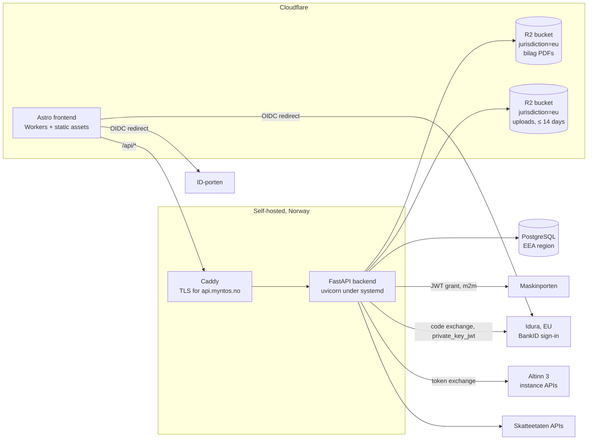

# Architecture

> Facts below about Skatteetaten/Digdir/Cloudflare were researched and
> verified against official sources in July 2026. Re-verify anything
> load-bearing before implementing against it — government APIs move.

## System overview



## Accounts, organizations and login

Myntos has its own accounts, entirely separate from the government auth below.
A user signs in with **email and password**, with **Google** or **Microsoft**,
or with **BankID** through a broker; all of them land in the same account
model. BankID here is a login to Myntos and nothing more: it is not ID-porten,
and **ID-porten is never a way to sign in**, because Digdir's terms for private
customers allow it for reaching public services (the filings below), not as a
product's own login. Nobody should try to make it one.

### The company is the tenant; the account only owns companies

```
Organization ─── OrganizationMembership ── User ─┬─ password hash
  (an account)      (may add companies)          ├─ UserIdentity (google, microsoft, bankid)
        │                                        │
        └─ Company (orgnr) ─┬─ CompanyMembership ┘  (role, access, per company)
              (plan)        └─ ledger, bilag, MVA
```

**This changed on 2026-09-03, and the shape above is the point.** Access used to
be account-wide: one membership row let a person into every set of books on the
account. That is right for a sole trader with one company and wrong for
everybody else. A regnskapsfører keeps one company per client, and "help me with
this client" was not expressible; worse, the invitation form sat under the
account, so what it actually granted was invisible. See
[company-isolation.md](company-isolation.md).

- **`Company`** is a bookkeeping-obligated entity with an orgnr, and it is the
  unit of access, of billing (`plan`) and of everything a person looks at. A
  regnskapsfører is one account with many companies and a different set of
  colleagues on each; a single AS is one account with one company. `orgnr` is
  unique *per organization*, not globally, so two accounting firms can each keep
  a set of books for the same client. A **confirmed** claim on an orgnr is the
  one thing that is globally unique (see below). Everything the row says about
  the entity itself comes from Enhetsregisteret rather than from a form.
- **`CompanyMembership`** is what grants access: one row per person per company,
  carrying the role. Roles are `owner`, `admin`, `member`, `viewer`, and the
  role → permission table lives in exactly one place
  (`domain/identity/access.py`) — no endpoint compares roles itself. Two rules
  are load-bearing: only an owner may create, demote or remove an owner (else
  the owner/admin split is decorative), and the last owner may not leave (books
  nobody owns can be neither billed nor shared). The same person can own their
  own books and merely read a client's.
- **`Organization`** is the account somebody signs up for. It answers two
  questions and no others: which companies were set up together, and who may add
  another one (`organization:manage` on `OrganizationMembership`). **Nothing
  displays its name**, and no rule may ever copy a company's name onto it: an
  account is routinely called after its first company, and such a name printed
  near a *different* company is indistinguishable from a leak. It was reported
  as one. See migration `c4d7e81f2a90`.
- Somebody invited to a company gets **that company and nothing else**: no
  membership of the sender's account, no sight of its other clients, and no way
  to add companies to it.
- Colleagues join through an **invitation** addressed to an email address, which
  names the company it is for. Only
  the token's hash is stored, it is single-use, and the accepting account's
  address must match the invited one — a forwarded link is not a ticket in.
  An invitation may also carry the **name** of the person it is meant for, which
  is a label and never a check: it greets them in the email and lets the
  company's board list show that they have been asked. Because the token cannot
  be recovered, re-sending issues a new one on the same row and kills the old
  link, rather than making the inviter revoke and retype the address.
- **`UserGovernmentIdentity`** records which person is behind an account, as
  ID-porten asserted it. Written by the ID-porten callback and by nothing else,
  after the assurance-level check. Deliberately not the same row as the
  short-lived `GovernmentLoginAttempt`: an authorization expires within the
  hour, and who somebody is does not. It is what lets the board list in
  Enhetsregisteret say which registered role holders can open the books. See
  [register-access.md](register-access.md).

### Confirmed ownership

Creating a company proves nothing: anyone can type nine digits into a form. So a
set of books starts **unconfirmed**, and `POST /api/v1/companies/{id}/bekreft`
is what turns it into a claim — the caller's ID-porten login is spent on
Altinn's own list of parties they may act for
(`integrations/altinn/authorized_parties.py`), and only an orgnr on that list
may be confirmed. It is the same evidence a submission later rests on, which is
the point: the confirmation is not a second, weaker check of our own invention.

Three columns record it (`verified_at`, `verified_by_user_id`,
`altinn_party_id`).

**More than one set of books may be confirmed for an orgnr, and never without a
warning.** Until 2026-10-22 a unique index allowed one confirmed claim per orgnr
across the installation, and the second account to confirm was refused even
when Altinn, through that person's own login, said they may act for the
company. The owner changed that: a person Altinn lets file for a company must
not be stopped from doing it from Myntos by somebody else's books, often books
they cannot even name. So the rule became a question (migration
`c3e7a1f95d20`). The first attempt on an orgnr another account has confirmed is
refused with 409 `company_already_claimed`; the page asks «Er du sikker på at
du vil fortsette?», and «Ja» sends `even_if_claimed`, which confirms these
books too. Altinn is asked either way: the yes waives the warning about other
books, never the rights.

The warning is the part that is load-bearing. Two confirmed sets of books can
both file the MVA-melding and the skattemelding, and Skatteetaten takes the
later filing as a correction of the earlier one. Nobody should be in that
position without knowing the other books exist, so the question is asked
every time and an API caller has to send the yes explicitly.

The warning, and the «Registrert av en annen» mark on the Altinn list
(`GET /skatt/altinn/authorized-parties`, field `claimed`), deliberately do
**not** name the organization holding the other claim, which the caller is not
a member of: they answer only for orgnrs Altinn has already said the caller may
act for, so the flag discloses nothing they could not learn by trying. The
other way forward the message names, asking an administrator there for access,
is still usually the better one; a regnskapsfører keeping their own copy of a
client's books can also simply leave them unconfirmed.

Nothing is gated on it. An unconfirmed company books, invoices and reports
exactly like a confirmed one — bookkeeping does not wait for BankID on a Sunday
evening. What the confirmation settles is *whose* company it is. Until it is
settled, the header carries a small red dot beside the company name and
`/organisasjon/` opens with a yellow banner and a **Bekreft selskapet** button.
The dot says only "look here"; the banner says the rest, at full size, where the
button that fixes it is.

### What comes from Enhetsregisteret

The register is asked for everything it has, not for a name and an address.
Every field left out is a field somebody types instead, and typing is where a
set of books ends up describing a subtly different entity.

`GET /api/v1/enhetsregisteret/{orgnr}` returns the whole entry — organisasjonsform,
business and postal addresses with kommune, næringskoder, contact details,
stiftelses- and registreringsdatoer, employee count, sector code, share capital,
vedtektsfestet formål, former names, konkurs/avvikling markings, and, for a
subunit, the `overordnetEnhet` it belongs to.
`GET /api/v1/enhetsregisteret/{orgnr}/roller` returns who holds a registered
role: styre with its leder, medlemmer and varamedlemmer, daglig leder, innehaver,
revisor, regnskapsfører, forretningsfører, bostyrer, kontaktperson. Roles live on
the main unit only — `/underenheter/{orgnr}/roller` is a 404 — so a subunit's are
read from its parent.

Two things are dropped on the way through, both deliberately. The register pairs
every person with a **birth date**; it never reaches a browser, for the reason
fødselsnummer never reaches one from the Altinn party list. And a role the
register has ended is filtered out rather than shown greyed: the list answers
"who may act for this company today", and a former daglig leder in it is a wrong
answer, not a historical note.

A small subset is **stored** on the company — `industry_code`,
`industry_description`, `website`, `phone`, `email`, `parent_orgnr`, alongside
the address and registration flags that were already there — because something
in the system uses each of them: the næringskode for a næringsspesifikasjon, the
contact details for a salgsdokument. `register_synced_at` is what makes that a
cache rather than a second opinion. The rest is fetched live for display and
never persisted: it changes without telling us, and some of it is other people's
personal data.

`POST /api/v1/companies/{id}/hent` re-reads it and **answers with the list of
fields that moved**. A refresh that silently rewrote the VAT flag would change
what every future invoice claims without anyone being told. Two rules keep it
honest: a null from the register means "we never had this", not "delete what you
stored"; and the **name is never overwritten**, because a name somebody edited
on purpose and one that has gone stale are indistinguishable from the server —
the register's name is shown beside the stored one instead.

The refresh also runs by itself when a company is created and when one is
confirmed, both best-effort. Brønnøysund being slow must not turn a completed
signup into an error page.

### Where the organization's name comes from

Signup does not ask for one. People who are not accountants do not think of
themselves as having an "organization", and a required field there is a wall in
front of the first screen. So signup invents `"Kari Nordmann (privat)"` and sets
**`organization.name_is_placeholder`**.

That flag is stored rather than recomputed, because it cannot be recomputed: the
user may have changed their own name since, and comparing the current name
against the generated string would guess wrong for exactly those people.

**An account is never named after one of its companies.** It was, until
2026-09-03: `POST /api/v1/companies` called
`identity.service.adopt_name_if_placeholder`, so setting up the first set of
books renamed a placeholder organization to that company's name. The intent was
a header that did not say "Kari Nordmann (privat)" next to an orgnr looked up
from Enhetsregisteret.

The header stopped showing the organization's name long before that mattered,
and the cost outlived the benefit: an account called after one of its own
companies is indistinguishable, on screen, from one company's data appearing
under another company's name. With two companies on the account, the settings
page said `Lindeman Technologies` on the account card while the header said
`DIALGA AS`, and it was reported as a leak. The function is gone, migration
`c4d7e81f2a90` gave the borrowed names back, and
[company-isolation.md](company-isolation.md#the-account-is-not-a-company)
is the rule not to reintroduce it.

So a placeholder name stays until somebody chooses one. `PATCH
/api/v1/organizations/{id}` is the only thing that clears the flag.

Only the organization endpoints expose it (as `name_is_placeholder`); `GET
/auth/me` does not. No page shows an account's name or offers to rename one,
because a name nobody displays cannot be mistaken for a company's
([company-isolation.md](company-isolation.md#the-account-is-not-a-company)). The
flag still earns its keep where the name is personal data: deleting the account
(`domain/identity/erasure.py`) renames a placeholder made from the person's name
to `Konto {id}`, and leaves a name somebody chose alone.

### Credentials and sessions

- The **password hash** (Argon2id) sits on the user; each **federated login** is
  a separate `user_identity` row. One person can hold both, so someone who
  signed up with a password and later clicks "log in with Google" keeps the same
  account, memberships and audit trail instead of forking a second one.
  **Except with BankID**: an account with a `bankid` row has no password and no
  other provider, because BankID's terms forbid using a BankID login to set up
  or restore a sign-in of our own (ID-veksling). Moving between BankID and
  e-mail is a switch, in either direction; see
  [BankID is the only way in](#bankid-is-the-only-way-in).
- A federated identity is only linked to an **existing** account when the
  provider asserts the email is **verified**, or when the person links it from
  `/konto/` while signed in to that account. Matching on the address alone is
  the classic federated-login account-takeover — Microsoft's nOAuth advisory is
  the same bug — and refusing is the whole defence. A *new* account is created
  either way, because there is nobody to take over and refusing would block
  every Microsoft user (see below); it is simply recorded as unverified.
- **BankID asserts no address at all**, so the rule above has nothing to work
  with, and three narrower ones replace it (see
  [Federated providers](#federated-providers)): a BankID login signs in only an
  account it is already linked to; linking happens only from a signed-in
  account; and a BankID signup asks for an address and **refuses one that
  already has an account** rather than joining it. The verified-address rule
  above also stops at a BankID account: Google with that account's verified
  address is refused (`email_belongs_to_bankid_account`), not linked.
- **Sessions are server-side and revocable**: an opaque 256-bit token in an
  `httpOnly; Secure; SameSite=Lax` cookie, stored only as a SHA-256 digest. A
  stateless JWT was rejected because "log me out everywhere" and "lock this
  compromised account" have to take effect immediately on a system holding
  accounting records. Non-browser clients can ask for the same token as a bearer
  token instead.
- **Keys for agents and integrations** are a third credential beside the
  session, and never a way into the account. A person makes one per company
  in the Tilgang section of `/organisasjon/`, once an owner or admin has
  switched keys on for that company, and their agent exchanges it once for a
  15-minute access token and a rotating refresh token (`myntos_ck_`,
  `myntos_at_`, `myntos_rt_`; SHA-256 digests only, like sessions). A key
  reaches only the routes that declare a key scope, in its own company only,
  with its person's role as it stands on each request, and some routes no key
  reaches at all: filing, money, access, the account. The rules and the
  reasons are in [agents-and-api.md](agents-and-api.md).
- **The operator key** is a fourth, and belongs to no person and no company:
  one per deployment, `myntos_op_` and 256 random bits, its SHA-256 digest in
  `OPERATOR_KEY_SHA256`. It opens `/drift/` (every stranger's feedback, and
  the server's failures) and nothing else, and no session or company key opens
  that. Unset, the routes answer 404. A leaked one can set a status and no
  more; replying, publishing and deleting feedback stay in the shell. See
  [operator.md](operator.md).
- A person sees and ends their own sessions at `/konto/`
  (`GET /account/sessions`, one or all the others). The list shows a coarse
  "Firefox på Linux" derived from the stored user agent, never the raw string
  or the IP address; see [gdpr.md](gdpr.md#the-session-list).
- **Deleting an account** (`POST /account/erasure`) takes the person and leaves
  the books. Credentials, identities, the fødselsnummer, sessions and
  memberships go; an account that vouchers, bilag or filings still name stays as
  a **tombstone** with its id and name, because the books must keep saying who
  registered each entry. Refused while the person is the last owner of books
  somebody still needs. The whole line is drawn in [gdpr.md](gdpr.md).
- Cookie-authenticated **writes** additionally require an `Origin` in the CORS
  allow-list, as a second layer behind `SameSite`. Bearer-authenticated requests
  skip the check — the header has to be attached deliberately.

**Email** is a handful of messages and two transports. The first is the
invitation, composed in `domain/identity/invitation_mail.py` and sent inline by
the endpoint that creates the invitation, so the response can say whether it
went; the address confirmation, the password reset and the three BankID ones
are below. The Myntos mark
travels inside the message as a related MIME part (`core/brand.py`), never as a
URL: a remote logo is a blocked image in most clients and a read receipt in the
rest, and the word "Myntos" sits beside it as text so a blocked one still names
the sender. `core/mail.py`
holds both transports, SMTP (`SMTP_HOST`) and Cloudflare Email Sending
(`CLOUDFLARE_ACCOUNT_ID` + `CLOUDFLARE_EMAIL_TOKEN`), and `MAIL_FROM` decides
the sender for either. Both put the same bytes on the wire: `build_message`
composes the MIME message once and Cloudflare's `send_raw` endpoint takes it as
composed, so the transport never changes what a recipient reads. A deployment
that configures neither is a supported deployment: nothing is sent, the
interface says so, and the invite link is returned to the inviter once, to pass
on by hand. A refused relay, an unreachable API and a permanent bounce are all
reported the same way and never roll back the invitation, which already exists.

This deployment sends through Cloudflare, on `myntos.no`, whose SPF, DKIM and
DMARC records `wrangler email sending enable` wrote and maintains. The endpoint
is `POST /accounts/{account_id}/email/sending/send_raw` with `from`,
`recipients` and `mime_message`; checked against Cloudflare's API reference on
2026-10-09. A recipient listed under `permanent_bounces` *or*
`suppressed_recipients` in a successful response is reported as not sent.

**The rest are about a person's own account** (`domain/identity/
account_mail.py`, tokens in `domain/identity/email_tokens.py`, table
`user_email_token`, migration `c5e8a17d3f42`): a link that confirms the address
of a password signup, a password-reset link, and for a BankID account the
answer to a reset request (no link), the link that switches it to e-mail, and
the notice that an account was switched to BankID
([BankID is the only way in](#bankid-is-the-only-way-in)). Both are minted like an
invitation token (256 random bits, SHA-256 digest stored, single-use, a
deadline) and carry a **purpose** that is part of every lookup, so a
confirmation link can never reset a password. Asking for a new link of one kind
kills the older ones, so only the newest message in an inbox works. Redeeming is
a conditional `UPDATE ... WHERE consumed_at IS NULL`, which is what makes
single-use hold under two simultaneous clicks. The links put the token in the
**fragment** (`/nytt-passord/#token=...`), not the query string as the older
invitation link does, so it never reaches a server log or a Referer.

- **Confirmation** is mailed at signup (in a background task, so signup never
  waits on a relay) and on request from the front page's notice. It stamps
  `email_verified_at` and signs nobody in, because a mail scanner may follow it
  and a different browser may open it. Lifetime `EMAIL_VERIFICATION_LIFETIME_HOURS`.
- **Reset** is requested anonymously at `/auth/password/forgot`, which answers
  the same 202 and empty body for an address with an account, one without, a
  deactivated one and one past the hourly cap, and sends the mail **after** the
  response so relay latency is not a second answer. What remains is one insert
  the unknown address does not get, which is far inside network jitter; a decoy
  row per typed address would be a table of strangers' addresses kept for
  nobody. Completing a reset revokes **every** session of the account (the
  caller's too, unlike a password change, since nobody here proved they were the
  one signed in), stamps the address confirmed, and lifts the login lockout,
  which bounds guessing and nobody guessed. No session is issued. Lifetime
  `PASSWORD_RESET_LIFETIME_MINUTES` (30). **A BankID account never gets a reset
  link**: the same 202, and a mail saying it signs in with BankID, recorded as
  a `bankid_notice` row so the cap counts it; the reset endpoint refuses a link
  for one anyway (`bankid_account`).
- **Throttle:** `ACCOUNT_MAIL_MAX_PER_HOUR` links of one kind per account per
  rolling hour, counted from the token rows: the mail-side twin of the per-account
  login lockout, and like it, bounding one address rather than a sender.
  Signed in, the limit is a 429; anonymous, it is silently the same 202.
- **Without mail configured** none of this is offered: `/auth/providers` says
  `email_delivery: false`, the login page shows no "Glemt passordet?", the
  notice never appears, and both request endpoints answer 503 (a fact about the
  deployment, identical for every address).

**What an unconfirmed account may do: everything it could before.** Every
password account made before 2026-10-09 is unconfirmed, because nothing could
confirm it, and the migration refuses to backfill a check that never happened.
So confirmation gates exactly one thing: an invitation from an unconfirmed
account is sent **without naming the inviter's address**, because anybody can
sign up as somebody else's address and a message from our domain must not send
a stranger's questions to it. Accepting an invitation is not gated: the token in hand
is the proof, and the address match is already required. Squatting an address
by signing up as it is answered by the reset flow: the real owner receives the
reset link, and completing it ends the squatter's sessions, password and keys,
and on an account never confirmed also every linked provider, since a Google or
Microsoft login is matched on its own subject and would let the squatter
straight back in. A Google or Microsoft login that vouches for the address does
the same when it lands on an unconfirmed account
(`service.sign_in_with_provider`, `ProviderSignIn.reclaimed`): stamping the
address confirmed and keeping the squatter's password would have handed them
every set of books the owner was later invited to. **Not
for a BankID signup**, which a reset never reaches: an address squatted that way
stays squatted until a release for unconfirmed addresses exists (a gap,
[integrations/bankid.md](integrations/bankid.md#gaps)).

### What the mail provider sees

Mail is the one path where Myntos' "nothing leaves the EEA" rule cannot be
fully kept, and the design limits what crosses it instead. Cloudflare's Email
Sending documentation makes no data-location commitment (unlike R2's
`jurisdiction=eu`), and the recipient's own mail server is wherever the
recipient chose. So every message is written on the assumption that its full
text is read outside the EEA:

- **What it sees:** the recipient address, the subject, the body and the
  sender. For an invitation that is the inviter's name and, once they have
  confirmed it, their address, the company's name, the role and the link; for
  the account mails, the person's first name and the link.
- **What it never sees:** accounting data. No amounts, bilag, parties, MVA or
  SAF-T content is ever put in a message, and nothing may be added that would
  be. A company's name is public in Enhetsregisteret already.
- **The links are credentials** while they live, so they are short-lived and
  single-use: 30 minutes for a reset, two days for a confirmation, seven for an
  invitation, each dead once used or superseded.
- **No tracking:** no remote images (the mark is an inline MIME part), no
  redirecting link wrappers, nothing fetched when a message is opened.

SMTP through a relay in the EEA is the alternative for a deployment that wants
the transport itself inside the EEA; the bytes are identical either way.

**Handed over is not delivered.** Cloudflare answers a send with the address
under `queued` and runs its spam filter afterwards, so "sent" in the API
(`email_sent`) means the service took the message and nothing more. On
2026-10-13 and 2026-10-23 it refused three invitations that way, each at
exactly its threshold (5 of 5) while the account mails passed at 4; the page
had said «Invitasjonen er sendt» and hidden the link, so nobody knew. Three
things follow, all in `core/mail.py` and the invitation pages:

- **The invitation pages always show the link**, whatever `email_sent` says.
  It is shown once (only a hash is stored), and hiding it took the only way
  forward from the one inviter who needed it.
- **Every message carries `Date` and `Message-ID`**, which RFC 5322 requires
  and none had, and **no invitation carries a Reply-To**: the inviter's
  address on another domain than `From` is how a phishing message is built,
  and the refused invitations were the messages that had one (three against
  three: a correlation, not a proof). It is named in the text instead.
- **Each send is logged with Cloudflare's message id** (`mail queued by
  Cloudflare: <…>`) and no address. Whether a message arrived, and its spam
  score, is in Cloudflare's GraphQL analytics, dataset `emailSendingAdaptive`
  on the `myntos.no` zone, kept 31 days. The `CLOUDFLARE_EMAIL_TOKEN` cannot
  read it; a token with zone analytics can. Cloudflare counts a refusal
  against the account: above 3% of a week's mail it is "At Risk" and may be
  paused, which would stop password resets too.

### Federated providers

One OIDC implementation (`auth/oidc/client.py`), several providers as data
(`auth/oidc/providers.py`): authorization-code flow with PKCE, `state` and
`nonce` in an `oauth_login_attempt` row, and full ID-token verification.
The `state` is also bound to the browser that started the flow: `start` sets
a short-lived httpOnly cookie on the API holding its digest
(`api/deps.py` `bind_flow`), and a callback without it is refused
(`innlogging_annen_nettleser`). A single-use, unguessable state is no defence
when the attacker is the one who started the flow and stopped short of the
callback: opened in somebody else's browser, that link signed them into the
attacker's account, and what they then typed, uploaded or proved with
ID-porten belonged to it. The ID-porten flow carries the same cookie, and its
callback also requires the session to be the account that started it.
`/auth/{provider}/start` and `/auth/{provider}/callback` are generic, and
`/auth/providers` lists only what this deployment has credentials for — so a
button can never lead to a 503. Adding a provider needs no migration:
`user_identity.provider` is a VARCHAR precisely so the list can grow. This is
Myntos's own login plane and shares nothing with the government login
(`government_login_attempt`, `auth/idporten/`), for the reason
[The two auth planes](#the-two-auth-planes-this-is-the-part-everyone-gets-wrong)
gives; BankID below uses this plane's tables, not that one's.

Between Google and Microsoft, which both carry an address, three things
genuinely differ, and each has bitten real systems:

| | Google | Microsoft (Entra ID) |
| --- | --- | --- |
| Issuer check | two accepted spellings | discovery returns a `{tenantid}` **template**, resolved against the token's own `tid` (validated as a GUID first) |
| Email verified | `email_verified` | **not sent** — `xms_edov` optional claim instead |
| Email claim | `email` | `email`, falling back to `preferred_username` |

The Microsoft row is the interesting one. Entra ID never emits
`email_verified`; the equivalent is `xms_edov` ("email domain owner verified"),
an optional claim that has to be switched on in the app registration and that
exists as Microsoft's own remediation for nOAuth. Absence therefore reads as
*unverified* — which stops a Microsoft login from being attached to an existing
Myntos account, without preventing a new one. `MICROSOFT_TENANT` is an
authorization boundary rather than a formality: `common` lets any Microsoft
tenant in the world start a sign-in.

#### BankID, through a broker

**BankID** comes through an OIDC broker, Idura by default (formerly Criipto,
part of Stø, which runs BankID; Denmark, EU-only processing per its data
processing agreement). The broker is configuration (`BANKID_ISSUER`,
`BANKID_CLIENT_ID`, `BANKID_REDIRECT_URI`, and a key or a secret); the verified
values, the page each one was read from, and the dashboard steps for sandbox and
production are in [integrations/bankid.md](integrations/bankid.md). Three
things set it apart from the providers above:

- **It authenticates the client with `private_key_jwt`**, Idura's
  recommendation, using the same key handling as ID-porten
  (`auth/signing_keys.py`). A secret works too.
- **It says who somebody is and not how to reach them.** No email comes back,
  so `OidcProfile.email` is `None`, `ProviderConfig.asserts_email` is false, and
  none of the address rules above can apply. The broker's `sub` is the only
  thing stored (`user_identity.subject`; `email_at_provider` stays NULL). The
  **fødselsnummer is not asked for** (`scope=openid`, never `ssn`): signing in
  needs a stable identifier and `sub` is one, and the number would need a
  "saklig behov" under personopplysningsloven § 12 that a login does not have.
  If one arrives anyway it is discarded. See [gdpr.md](gdpr.md#bankid).
- **Every login is a fresh one** (`prompt=login`), never a reused broker
  session, because deleting an account without a password trusts a login from
  the last ten minutes as proof that its owner is at the keyboard.

What happens to a verified BankID depends on what the flow was started for,
which is recorded on the attempt (`oauth_login_attempt.intent`, migration
`7a3e5c1d9b24`) because it cannot be inferred from the answer:

1. **`login`: sign in an account it is linked to, and only that.** An unlinked
   BankID is refused (`no_linked_account`), with no session and nothing
   created. A login button never makes an account.
2. **`link`: from `/konto/` ("Koble til BankID"), signed in, and a switch**:
   when it completes, BankID is the account's only way in (below). It starts
   with `POST /auth/bankid/link`, which wants the password first, never with a
   GET to `/start` (`bytte_ikke_bekreftet`). The attempt
   records who started it (`oauth_login_attempt.user_id`), and the callback
   refuses unless the session it arrives with is that same account
   (`kobling_annen_konto`). Without the check, somebody could start a link on
   their own account and hand the BankID page to a victim, whose BankID would
   then open the attacker's books under a name the victim recognises. A BankID
   already linked elsewhere is refused (`identity_already_linked`); one account
   has at most one per provider. **This is the only way a BankID reaches an
   existing account**, because it is the only place both halves are proved in
   one flow: the account by its session, the person by BankID.
3. **`signup`: from `/registrer/`.** A BankID that is already linked simply
   signs in. One that is not is held for half an hour
   (`pending_provider_signup`: `sub`, the name, a token digest, a deadline;
   deleted when used, swept when expired) and the browser goes to
   `/fullfor-registrering/#token=…`, which shows the name and asks for an
   address. The account is created with BankID's name, the typed address
   **unconfirmed**, no password, and the ordinary confirmation mail. **An
   address that already has an account is refused, never joined**: the address
   is only what was typed, and attaching a BankID to whichever account owns it
   would let anyone with a BankID take over anyone's account by typing an
   address. The refusal says to sign in the usual way and link BankID from
   `/konto/`; the hold survives it, so another address can be tried. What it
   makes is a BankID account, and `/registrer/` says so beside the button.

**Unlinking** (`DELETE /account/identities/{provider}`) is refused
(`last_sign_in_method`) when it would leave no password and no other provider,
and refused for BankID always (`bankid_account`; the way out is the switch
below). `GET /account/identities` says per row whether it may go, so the page
never offers a button the backend would refuse.

##### BankID is the only way in

**An account that signs in with BankID signs in with nothing else.** Stø's
merchant terms (§ 7.2, definition (l)) forbid *ID-veksling* without a separate
paid permission: using a BankID login "to activate, restore or increase trust
in the Merchant's identification or authentication mechanism", and the
Norwegian permission terms add in so many words that authenticating customers
with BankID as the basis for the merchant's own "pålogging" is covered. BankID
as the login every time is ordinary authentication; an account BankID set up
or vouched for being opened afterwards with our own password is not. The owner
decided on 2026-10-10 that the two are mutually exclusive rather than to buy
the permission. The quotes, sources and open questions for Stø are in
[integrations/bankid.md](integrations/bankid.md).

- **The `bankid` row is the marker** (`service.is_bankid_account`), and nothing
  else is, so there is no flag to drift from it and no migration. Every path
  that could add a way in asks: reset, change password, password login, linking
  or signing in with Google or Microsoft, unlinking. That includes a password
  left from before the rule.
- **Linking BankID is a switch.** It starts with `POST /auth/bankid/link`, which
  wants the password (or a login in the last ten minutes, as deleting the
  account does), never a GET: otherwise a hijacked session could swap the
  owner's password for its own BankID and, since a reset never reaches a BankID
  account, keep the account for good. The callback clears the password, deletes
  every other identity, retires password links, revokes every other session and
  mails the address.
- **Leaving BankID goes through the inbox.** `POST /account/switch-to-email`
  mails a `switch_to_password` link to the account's own address and changes
  nothing; `POST /auth/switch-to-email/confirm` with that link sets the
  password, deletes the BankID row, confirms the address and revokes every
  session. It is the one step a BankID session starts, and it is built so the
  link, not BankID, is what makes the password.
- **Nothing is "BankID-verified."** A BankID sign-in raises no badge and no
  `bekreftet` in the register match; the name it gave is an account name like
  any other ([register-access.md](register-access.md)).

A token from a different eID on the same broker (`acr_values` sits in the
address bar, where anybody can edit it) is refused when the token says which
scheme ran: Idura's `identityscheme` must be `nobankid-oidc`. The returned
level of assurance is not checked, unlike ID-porten's, because Idura documents
no `acr` claim in the token; for a login that is a deliberate trade, and the
filings keep their own check at level high.

**Vipps Login was removed on 2026-10-10**, having never been configured in
production. It needs a merchant agreement that costs from 300 kr a month, and
Vipps stops releasing the fødselsnummer in Norway from 2027-01-01, which takes
away the one thing it would have offered over the providers already here.
`user_identity.provider` is a VARCHAR, so no migration had to drop the value;
`7a3e5c1d9b24` refuses to run if a `vipps` row exists anyway, because the ORM
could no longer read one.

## The cash-flow register

The first thing a user can actually do. One payment in or out per entry, and
three questions: how much moved, when, and **what it was for**.

That third one is the whole design. A bank statement cannot tell a deductible
cost from a private withdrawal, and the difference is exactly what the
næringsspesifikasjon and the MVA-melding are built from. So the register asks,
with a catalogue of types (`domain/ledger/cashflow.py`) that each carry:

- the **account** the amount books to — and through that account, the per-year
  `GroupingCategory`/`GroupingCode` that becomes a skattemelding post;
- the **default VAT code**, which is what the MVA-melding aggregates over; and
- a **note stating the assumption**, because the default is a default. Rented
  premises carry VAT only if the landlord is voluntarily registered, a car
  expense is deductible for a van and not for a passenger car. The user can
  override the code, and the note is shown next to the choice. Guessing
  silently is what turns a bookkeeping tool into a liability.

Mechanically an entry is an ordinary voucher, not a parallel structure:

```
Salg 1 250 kr, 25 % mva                 Kontorrekvisita 625 kr, 25 % mva
  1920 Bank        D 1250                 6800 Kontorrekvisita  D  500  ← mva-kode her
  3000 Salg        K 1000  ← mva-kode her 2710 Inngående mva    D  125
  2700 Utgående mva K  250                1920 Bank             K  625
```

- The user enters the **gross** amount, because that is the number on the bank
  statement. `posting.split_gross` derives the net as `gross / (1 + rate)` and
  the VAT as `gross - net` — never `net * rate`, which rounds the two halves
  independently and leaves vouchers an øre out of balance.
- `TaxInformation` goes on the **basis** line, never the VAT-account line
  (`posting.set_tax_information` is the single writer, so the two callers
  cannot drift).
- Entries are **posted immediately** — the money has moved, there is nothing
  provisional about it — and are therefore immutable. A mistake is undone by
  reversal, and `gl_transaction.reverses_transaction_pk` records which entry
  was undone so an auditor can see both, and so nothing is reversed twice.
- **Every voucher records who entered it**
  (`gl_transaction.created_by_user_id`), because access is a row per person per
  company and a journal is therefore frequently written by more than one hand.
  `system_entry_date` said when the system recorded an entry and nothing about
  by whom, which is fine for a sole trader and useless the moment a
  regnskapsfører and the owner are posting into the same journal. A reversal
  and a correction record **whoever performed them**, not whoever made the
  entry being fixed: those are different people often enough that copying would
  misattribute the one action a reader most wants attributed.
  The column is nullable and stays that way — rows predating it, GDPR erasure
  taking the person and leaving the record (`ondelete="SET NULL"`, since a
  posted voucher outlives every account), and any future job that posts with
  nobody logged in. It reaches the SAF-T export as `Transaction/SourceID`, the
  user's id; an earlier version of this paragraph said the standard had no such
  element, and it does. The register shows the mark only
  when a set of books has more than one author (`frontend/src/lib/authors.ts`).
- Creating a company **seeds** a starter kontoplan, the VAT codes with
  date-effective rates, the first financial year and its per-year account
  groupings. Without that, a new user's first action would be building a chart
  of accounts. Dates before the first financial year are refused: the seeded
  rates are only claimed to hold from then, and posting earlier would snapshot
  an invented rate onto the entry.

- **VAT registration decides the defaults, by the entry's date.** An
  unregistered company (or an entry dated before `vat_registered_from`) gets
  code 0 for every category, so the gross amount goes to the cost, and is
  refused codes that deduct or charge VAT. Switching the status moves what new
  entries are offered and never touches a posted one
  ([integrations/mva.md](integrations/mva.md#registration-status-built-2026-10-09)).
- A category may be booked to **another account of the same type** the company
  added to its kontoplan, never across types and never to a deactivated or
  locked account (`service._basis_account`).

**Composite entries** (sammensatt bilag, built 2026-10-12). One bank line is
often several trades netted together: a melkeoppgjør is milk sold less the
levy, the share in Tine and the feed set off; a Vipps payout is sales less a
fee; one receipt has food at 15 % and other goods at 25 %; an instalment is
interest and repayment. Under one category each is wrong somewhere, so
`service.record_composite` books **one voucher with one trade per line** and
one payment line for what they net to:

- Every line is built by `service._trade`, the same function an ordinary entry
  uses, so a settlement's milk line and a milk payment of its own cannot
  disagree about the rate, the deduction or which side the VAT goes on. Lines
  may go against the bank movement (a settlement is money in with deductions
  out); lines that net to zero are refused, because then no money moved.
- Each trade line records its category in `gl_transaction_line.entry_type`
  (`voucher_type` holds one, and this voucher has several), so the register
  reads it back line by line (`CashFlowView.parts`). The voucher is
  `voucher_type = 'sammensatt'`; a reversal copies `entry_type` with the rest
  of the line.
- It is posted, reversed and corrected like any other entry; a correction may
  turn an ordinary entry into a composite one (`PUT …/cashflow/sammensatt/{id}`),
  which is how a settlement booked as one sale is split afterwards. The
  MVA-melding and SAF-T read lines, so neither needed a change.
- `CashFlowType.deducts_from_sale` marks a deduction the buyer made on a
  settlement it wrote (the levy, the bunnfradrag): money out that books as the
  sale's side, so VAT on it reduces 2700 instead of claiming a deduction on
  2710.

**Add-ons** (built 2026-10-12, [landbruk.md](landbruk.md)). Myntos is for every
business, and an industry's needs come as an add-on rather than a different
product: categories with `segment` set are offered, proposed by the model and
accepted only in books that have that add-on, and its accounts are added to
those books' kontoplan alone. `landbruk` is the only one: NIBIO's farm
accounts, the farm's categories, and a bilag reader that reads a settlement
from Tine as the farm's sale.

**Who** the payment was with is a separate field: `Party`, SAF-T's `Customers`
and `Suppliers`. It is optional, because most payments have no counterparty
worth registering and demanding one makes people invent placeholder suppliers.
Each party settles against a balance account derived from its type
(kundefordringer or leverandørgjeld — SAF-T's `BalanceAccountStructure`), and
the reference goes on the **basis** line, like the tax information, because
that is the line describing the trade. The party number and type are fixed once
created: posted vouchers point at them, and SAF-T exports them per financial
year, so changing either would rewrite what past filings said.

**Bilag documents** attach to a posted voucher (`bilag_attachment` +
`myntos.storage`). PDF, PNG, JPEG, WebP, GIF and HEIC, each verified by magic
number rather than by the uploader's `Content-Type` or extension; the storage
key is generated and never derived from the filename; the SHA-256 is stored so the file handed to an auditor can be
proven to be the one uploaded. The archive is **append-only** — there is no
delete endpoint, because bokføringsloven § 13 requires primary documentation to
stay available for five years after the financial year ends. The one thing
that deletes a stored file is the daily purge of companies an owner deleted
from Myntos, and only once those five years are over
([gdpr.md § Deleting a company](gdpr.md#deleting-a-company)).

The original is kept **byte for byte**, EXIF and all, because it is the
primary documentation and a stripped copy would no longer be the file that was
uploaded. What *is* stripped is every copy made from it
(`domain/bilag/derived.py`): the register's thumbnails, and the JPEG a HEIC
photo is turned into for Løynd, which does not open HEIC. A phone photo carries
the GPS position it was taken at, and neither a colleague looking at the
register nor a model needs it, so a copy is redrawn from pixels onto a canvas
with no metadata at all (orientation applied first). Decoding happens in a
short-lived child process with a memory ceiling and a timeout, since it is
native code handed a stranger's bytes; a photo that will not decode is still
filed, it just has no thumbnail. PDFs get none either: that would need a native
PDF renderer, which is the thing pypdf was chosen to avoid.

None of this is a shortcut around the exporters. The register writes the same
tables the SAF-T export and the MVA-melding read, which is why it was
worth building on the ledger rather than beside it.

### Document storage

Two backends behind one `DocumentStorage` protocol, and one key format shared
by both, so a document moved between them keeps its key. The key is generated
(`yyyy/<uuid>.<ext>`) and validated on the way back out: nothing the uploader
supplies takes part in building a path, and a key that cannot express a
traversal cannot be talked into one.

Thumbnails live beside the archive under `derived/thumbnail/yyyy/<uuid>.jpg`,
computed from the original's key rather than stored, made on first request and
regenerable at any time. `save_derived` is the one write that may replace an
object, and it only accepts that prefix, so it cannot be pointed at a bilag.

- **local** — filesystem, development only. The production host writes only to
  the unit's `ReadWritePaths`, and nothing is backed up from there.
- **r2** — Cloudflare R2 over its S3 API, signed with SigV4. The
  **jurisdiction is part of the endpoint hostname**
  (`<account>.eu.r2.cloudflarestorage.com`), fixed when the bucket is created
  and unchangeable afterwards, so pointing at the plain hostname does not fail
  over — it silently writes accounting records outside the EEA.
  `R2_JURISDICTION` therefore defaults to `eu` and has to be turned off
  deliberately. Missing or blank credentials fail at startup rather than at the
  first upload.

SigV4 is implemented in `storage/sigv4.py` against httpx rather than pulling in
boto3: botocore is tens of megabytes of vendored service definitions and a
synchronous transport, for about two hundred lines of use. The algorithm is
published and fixed, the implementation is verified against AWS's own
`get-vanilla` test vector, and the failure mode is benign — a signing mistake
means R2 answers 403 on the first request rather than corrupting anything.

## Where the books start and where each year ends

`domain/arsoppgjor/`, `/inngaende-balanse/` and `/arsavslutning/` (built
2026-10-09). Both flows are review-then-post: the page asks the backend what
would be posted and what is wrong with it, and the post runs the same check
again.

**Inngående balanse.** A company whose earlier years were kept elsewhere posts
its balance sheet as **one balanced voucher in the `IB` journal**, dated the
first day of its first financial year in Myntos, typed or read from the old
system's saldobalanse as CSV (`saldobalanse.py`: separator, header wording and
Norwegian number formats detected, signed amounts read as debit positive; a file
read by a heuristic fills the form and is never posted directly). A voucher and
not stored opening rows, because a voucher is immutable, attributed, corrected
like everything else, and already counted by every reader: the bank position,
the customer's balance, the next year's derived opening. The SAF-T export is the
one reader that treats the journal differently ([saf-t.md](integrations/saf-t.md)).

The rules, and why:

- **Only the first year, only while it is open.** Every later year's opening
  balance already exists, derived from the year before; a second opening voucher
  would count it twice. Closing is the one thing that relies on it (the equity a
  loss is covered from), so a closed year refuses it.
- **Not "only before anything else is posted".** Books move to Myntos in
  January and the previous accountant's final saldobalanse arrives in March;
  refusing then would make the import useless to the people it is for, and
  nothing posted in an open year reads the opening balance. The register's year
  figures and listing leave the `IB` journal out (money carried in is not money
  received), while the cash position keeps it.
- **Balance-sheet accounts only, and not 2700/2710.** A result left on income
  and cost accounts has not been disposed of, and posting it would make it this
  year's result. Last period's unsettled VAT goes on 2740, because each Myntos
  settlement sweeps the period's 2700/2710 onto 2740 and would pull last year's
  VAT into this year's first term.
- **Open items (åpne poster)** on 1500/2400 name their customer or supplier, one
  line per item, on the party's own balance account; an account is split per
  party completely or not at all, since half a reskontro does not reconcile.
- **Corrections** reverse the standing voucher and post the replacement with
  `corrects_transaction_pk`, in one request. The register's reversal route
  refuses `IB`, `AVS` and `MANUELT` vouchers (`cannot_reverse_here`), so none
  of them can be undone around its own rules.
- **The old program's years**, from its SAF-T files, one per year, go into an
  `IMPORT` journal under the old program's voucher numbers, never over a period
  Myntos already has entries in. The earliest file's opening balances are the
  opening balance, and **years before the first year in Myntos are opened to
  take them** (`ledger.service.open_earlier_years`, the one exception to
  "nothing before the first year"): the seeded VAT rates are carried back only
  for codes whose lines in the files all had today's rate, so no rate is
  claimed that nobody proved. An opening balance standing in a later year is
  replaced by one in the earliest, in one step. The register neither lists nor
  reverses those vouchers; `/bilag/` lists them, and everything else counts
  them ([saf-t.md](integrations/saf-t.md#the-books-brought-over-on-the-server-built-2026-10-13)).

**Manuelt bilag** (`domain/manuelt_bilag`, built 2026-10-15). The year-end
adjustments (stock and livestock, accruals, depreciation, reclassifications)
have no payment behind them, and before this the accountant finished the year
in another program. A manual voucher is typed as accounts with debit and
credit, reviewed by the backend (`…/manuelt-bilag/kontroll`, findings in the
year-end's `feil`/`merknad` shape) and posted in its own `MANUELT` journal,
numbered per year. Three rules carry the weight:

- **A written reason is required**, at least ten characters, and kept in the
  append-only `voucher_explanation` table beside the voucher. A payment is
  documented by a receipt; an adjustment is a decision, and
  bokføringsforskriften § 5-12 wants the documentation to show why it is made.
  The table has no author column: the voucher's own `created_by` is the
  author, so account erasure (gdpr.md) needed no change.
- **VAT is never typed.** A line with a VAT code carries the gross amount and
  is split like a register line, with the VAT line generated on 2700/2710;
  a typed line on either account is refused. That is also what makes the
  read-back (`input_lines`, what a correction starts from) exact: in
  `MANUELT` every 2700/2710 line is generated. Border VAT and non-deductible
  reverse charge stay in the register, whose extra cost line could not be
  told apart on read-back. The closing accounts (8300, 8800, 8960, 8990) are
  refused, because the close would call them already disposed.
- **Corrections are their own routes.** `PUT …/manuelt-bilag/{id}` reverses
  the original in its own period and posts the replacement with
  `corrects_transaction_pk`; the reversal's reason names the replacement, so
  each piece of documentation points at the other (§ 5-12). A plain reversal
  needs a reason too. The register neither lists nor reverses these vouchers;
  `/bilag/` lists them, and the summary and bank matching count them.

**Årsavslutning.** At most two vouchers in the `AVS` journal on the year's last day: the
**tax cost** an AS states (8300/2500; Myntos does not compute tax or deferred
tax, and says so when an AS with a profit states none), and the
**disposition**, read off `company.organisation_form`:

| Form | Profit | Loss | Also |
| --- | --- | --- | --- |
| AS | covers udekket tap first (8990 → 2080), the rest to annen egenkapital (8960 → 2050) | covered by free equity on 2050, the rest carried as udekket tap on 2080 | 2060 with a balance is a merknad: an AS has no privatkonto |
| ENK | 8800 → 2050 | 2050 → 8800 | privatkonto 2060 closed against 2050; tax refused, the owner is the taxpayer |
| anything else | refused by name | | |

**A year brought over from the old program keeps what was booked there.** Its
tax cost (8300) and disposition (8800/8960/8990) in the `IMPORT` journal stand
as reported, and the closing disposes only what is left; refusing them as
"already disposed", as for anything on those accounts posted in Myntos, would
have left an imported year open for good, and every year after it.

Then `financial_year.closed_at` is set (every posting path already goes through
`ensure_financial_year`, which refuses a closed year), a `financial_year_event`
row is written, and the next year is opened. Years close in order, only after
they are over (Oslo date), and a period with VAT not yet settled onto 2740 is a
merknad, because its settlement belongs in the year and a closed year will
refuse it. Closing and reopening need **`ledger:close`** (admins and owners): it
locks every colleague out of the year.

**Reopening is allowed, explicit, logged, and never an erasure.** Bokføringsloven
protects the posted entries and their traceability, not a software lock, so
reopening touches no posted voucher: it **reverses** the closing vouchers, clears
the lock, and logs who and why. Only the latest closed year, and only with a
written reason and a confirmation that the årsregnskap has not been fastsatt.
After adoption an error is corrected in the open year against equity, which
Myntos cannot yet verify (Regnskapsregisteret is phase 6), so the confirmation is
the person's for now. Refusing outright would have pushed the ordinary late
supplier invoice into the wrong year.

Accounts 2000, 2080, 2500, 8300, 8800, 8960 and 8990 joined the seed chart for
this, and migration `c3f9a2d71e58` backfills them with the year log table.

**A dissolved company's last year ends on its last day** (`company.wound_up_on`,
migration `60bbbdaf279d`), set with `POST …/arsavslutning/opplosning`
(`domain/arsoppgjor/winding_up.py`). Every other year is a calendar year. The
last one has its `end_date` moved to the day, so it can be closed the day after
instead of in January, and so the SAF-T file and the næringsspesifikasjon
report the period the company existed; `ensure_financial_year` refuses a later
year and, given the voucher's date, a later day; closing it opens nothing
after it; and its skattemelding is a forhåndsfastsetting
(docs/integrations/skatteetaten.md). The day is the person's to state, because
Enhetsregisteret's deletion is usually weeks after the last payout, and it is
refused only where the books contradict it (anything dated after it). Undone,
logged, while the year is open and nothing has been filed on it.

## Work done after the answer

Since 2026-10-13 one feature does its work after its request has answered: the
previous program's SAF-T files, uploaded once into `saft_import`, are read and
posted by `myntos.saft.jobs` in FastAPI's `BackgroundTasks`, and the page polls.
Since 2026-10-22 the old program's printout of its vouchers with attachments
goes the same way, on the same table.
A year of vouchers was otherwise a tab that had to stay open through a long
upload, a read, a hundred small requests and a second and third upload of the
same file. The rules that hold it, so the next feature that needs the same
does not invent another:

- **No queue, no worker.** One uvicorn process, so the work runs in it, and
  which imports are in hand is a set in the process, like the agent keys'
  counters. More than one process would need a claim in the database first.
- **A restart loses nothing.** A read stores nothing until it is done and a
  post is one transaction, so the startup hook (`jobs.resume`, from the
  lifespan) simply runs again whatever a deploy stopped halfway.
- **The preview is the posting, rolled back.** The read runs the whole posting
  in a transaction it then rolls back; the post runs it again and commits. A
  preview made any other way can disagree with what is posted.
- **Sessions of its own**, through a dependency (`get_import_sessions`) so the
  tests' database is the one used: the request's session is gone by then.
- **Files in a store of their own, never the document store**
  (`storage/working.py`: a second R2 bucket, `R2_WORKING_BUCKET`), deleted
  once posted, thrown away, or 14 days after the upload: the document store is
  append-only on purpose (bokføringsloven § 13), and a working copy that must
  go again does not belong in it. They were a column in the database until
  2026-10-27, when Fiken's complete export (350 to 600 MB) showed what that
  costs: a value near Postgres's 1 GB ceiling, Neon storage and restore
  history, and the whole file twice through memory. Now they are written in
  parts and read as they download. A ZIP's SAF-T files are kept
  gzip-compressed (`saft/intake.py`), and an export with documents in it is
  kept whole too, until its documents are copied into the document store on
  the yes, on no voucher (`saft/archive.py`, docs/integrations/saf-t.md).
  `jobs.sweep`, once a day, deletes whatever no row points at, and the
  bucket's lifecycle rule (15 days) is the backstop for a sweep that never ran.
- **One exception to "the preview is the posting, rolled back"**: the old
  program's printout of the vouchers (`purpose` `vedlegg`, since 2026-10-22),
  whose post writes to the document store, which cannot roll back. Its review
  and its post both run `saft.documents.plan`, the review writes nothing, and
  the post goes ahead only while the plan is the one the review showed.

## Frontend

Astro, prerendered, no framework. The API lives on its own origin, so every
page talks to it with `fetch(..., {credentials: 'include'})`; the session cookie
is httpOnly, so no script on the page can read it — an XSS bug cannot exfiltrate
a login.

The front page is two pages in one file. What ships in the HTML is the
signed-out one: that is what a search engine indexes and what a visitor without
JavaScript sees. The signed-in overview is in a `<template>` and is put into the
page only once somebody is signed in; until 2026-10-22 it shipped beside the
pitch, hidden by CSS, and a crawler that reads text rather than CSS saw two h1s
and «Henter oversikten …» (docs/frontend-conventions.md, «What search engines
and AI assistants see»). `data-auth` on `<html>` decides which half is displayed, and it
starts at `"ut"`. To avoid a returning user seeing the marketing page flash
before their dashboard, an inline script in `<head>` reads a **hint** from
`localStorage` before first paint. The hint is not a credential and grants
nothing — `/auth/me` answers a moment later and overrules it either way.

The header is **company-first**: the company's name is the loud half and the
signed-in person is the quiet line beneath it, because every page in the
application is about a set of books rather than about an account — a
regnskapsfører switching client has to see *which* client at a glance, while
their own name never changes. The whole name opens the **company menu**,
because it is what somebody points at when they think "this company", and a
regnskapsfører with twelve clients should not go through a settings page to
reach the thirteenth. The menu lists the companies to switch between, then
«Legg til selskap» (only for those holding `organization:manage`), the
company's settings, and «Din konto» (`/konto/`). The **cog** beside it goes
straight to `/organisasjon/`, where a company is corrected and confirmed. A
**red dot** beside the name means nobody has confirmed the ownership yet; the
sentence explaining that lives in the banner on `/organisasjon/`, rather than
being read again on every page. `lib/company.ts` holds the one `/companies`
request the header and the page below it share.

The signed-in nav is deliberately four links — Oversikt, Betaling
(`/kontantstrom/`), Faktura, KI — plus the cog. «Betaling» rather than
«Kontantstrøm», because it is the word on the button people already press on
the overview and it names what they are about to do rather than the report it
ends in. It is not a table of contents: `/parter/` is reached from the invoice
and the cashflow entry, where a customer is actually needed; `/mva/` from the
VAT figure on the overview; and the rarer pages (`/bank/`, `/saft/`, the year's
opening and close) from the note under the overview's figures. A link present
everywhere is no easier to find than one present where you are.

| Page | Purpose |
| --- | --- |
| `/` | Marketing when signed out; overview, totals and recent entries when signed in |
| `/kontantstrom/` | The register: entry form, listing, reversal, bilag upload (several files at once, PDF or photograph, with a box for what the documents do not say) |
| `/faktura/` | Salgsdokument: line editor, a review step that shows the § 5-1 findings before anything is issued, kreditnota, PDF and EHF download |
| `/saft/` | The SAF-T Financial file for one financial year: the backend's cross-reference findings first, the download only when none of them blocks, the version offered only for years that accept two. Reached from the note under the overview's figures, and per year from `/slett-selskap/` with `?aar=`. See [integrations/saf-t.md](integrations/saf-t.md#what-myntos-does-built-2026-10-09) |
| `/kontoplan/` | The kontoplan for one year: every account, its post in the næringsspesifikasjon, adding, renaming, (de)activating, marking as a bank account (an account besides 1920 and 1900 that the overview counts as the company's money, such as a driftskreditt on 2390; `account.is_bank_account`) and regrouping. Changes need `ledger:chart`. Reached from `/organisasjon/`, `/saft/` and the account field in the register. See [integrations/saf-t.md](integrations/saf-t.md#the-kontoplan-is-editable-built-2026-10-09) |
| `/mva-justeringer/` | Uttak, tap på krav, justering and tilbakeføring: the MVA-melding's `spesifikasjon` lines, recorded and reversed. Reached from `/mva/`. See [integrations/mva.md](integrations/mva.md#spesifikasjon-uttak-tap-på-krav-justering-tilbakeføring-built-2026-10-09) |
| `/mva/` | The MVA-melding per period: every line, the deadline, Skatteetaten's check, a confirmation step before filing, the receipt and payment information afterwards, and the melding as XML for upload by hand. Reached from the VAT figure on the overview, not from the top menu. See [integrations/mva.md](integrations/mva.md#what-myntos-does) |
| `/bank/` | Bank reconciliation: upload a camt.053 file, see each movement next to the voucher that books it, confirm a suggested voucher or post a new one from the line through the register's own path. Matching is a link and never edits a voucher. Reached from the note under the overview's figures. See [integrations/bank.md](integrations/bank.md) |
| `/inngaende-balanse/` | The opening balance of books brought from another system: saldobalanse CSV or typed lines, open items per customer and supplier, the backend's review, then one voucher; correction is reversal plus replacement. Reached from the overview's note. See [§ Where the books start](#where-the-books-start-and-where-each-year-ends) |
| `/manuelt-bilag/` | Manual vouchers for one year: accounts with debit and credit, a written reason, optional documents, the backend's review, then one voucher in the `MANUELT` journal; «Rett» (reversal plus replacement) and «Reverser» with a reason on each. Reached from the overview's note, `/arsavslutning/` and `/bilag/`. See [§ Where the books start](#where-the-books-start-and-where-each-year-ends) |
| `/tidligere-program/` | «Hent regnskapet fra et annet program»: the old program's SAF-T files, one per year, uploaded once and read and posted on the server (see [§ Work done after the answer](#work-done-after-the-answer)); the review in tiles and folded lists; «Programmet du kommer fra», which adds what one program has (`lib/programs.ts`); with Tripletex chosen, «Vedlegg fra Tripletex», Tripletex's printout of the vouchers with attachments, each voucher's pages put on the voucher with its number ([integrations/saf-t.md](integrations/saf-t.md)); the parallel run's comparison. Reached from the overview (a card while the books are empty, and the note), `/inngaende-balanse/` and the move guides (with `?fra=` naming the guide's program) |
| `/bilag/` | The bilagsjournal: every posted voucher of a year from every journal, newest first, with its lines and its documents in the bilag archive; narrowed to an account, its movements and balance (1920: the bank's ins and outs), or to the vouchers with a document («Bare bilag med dokument»). Reached from «Se alle bilag →» on the overview and from a finished import |
| `/regnskap/` | Resultatregnskap and balanse for every year side by side, newest first, grouped by NS 4102 class, each line opening to its accounts and each amount to `/bilag/` (`domain/ledger/report.py`). Reached from «Regnskapet år for år» on the overview, which also says where the books stop once a VAT deadline has passed with nothing posted since (`positions_as_of` on the summary) |
| `/arsavslutning/` | One financial year's result, tax (AS) and disposition, shown line by line before a confirmed close; reopening with a reason and the log of both. Reached from the overview's note |
| `/skattemelding/` | An aksjeselskap's skattemelding and næringsspesifikasjon for a closed year: what stops it (each with a link to where it is fixed), the taxable result and the formue as Skatteetaten will compute them, every post with its accounts; the one question only the person can answer, Skatteetaten's check, a confirmation step before filing, the answer afterwards. Reached from the overview's note and from a closed year on `/arsavslutning/`. See [integrations/skatteetaten.md](integrations/skatteetaten.md#filing-from-myntos-built-2026-10-22) |
| `/parter/` | Customers and suppliers (SAF-T `Party`) for the active company: the register a counterparty is picked from. Reached from `/faktura/` and the register's entry form, not from the menu |
| `/datadeling/` | What each level of sharing with Myntos shares and keeps, public, drawn from `lib/datasharing.ts` like the choice on `/organisasjon/`. See [data-sharing.md](data-sharing.md) |
| `/ki/` | Where KI is used in Myntos and who runs the model, public; signed in, also the switch (`Company.ki_enabled`) that turns it off for one set of books, naming the company it applies to. See [§ KI](#ki-anywhere-in-the-product-one-provider-only) |
| `/godkjenning/` | What keys for agents and programs asked to do and that waits for the key's person: approve (runs the stored request as the key), decline with a reason the agent reads, or go to the MVA or Skattemelding page for a request to file. A request that sends something out of Myntos (`key_send`: a check or a filing with Skatteetaten) always lands here, and the card asks for the person's ID-porten login before «Godkjenn» when it goes with it. Decided ones below. In the top menu only while the company has keys switched on, with a count of what waits. See [agents-and-api.md](agents-and-api.md) rule 13 |
| `/nytt-selskap/` | Setting up books for another company: orgnr (or Altinn's list of companies the person may act for), then the books, then inviting colleagues. Reached from «Legg til selskap» in the company menu, and only for an account holder with `organization:manage` |
| `/logg-inn/`, `/registrer/` | Password sign-in, and one button per provider the deployment has configured (Google, Microsoft, BankID); a provider without credentials has no button. `/registrer/` starts a BankID flow with `intent=signup` |
| `/fullfor-registrering/` | The second step of a BankID signup: the name BankID gave, and the address the person types. Token in the fragment. An address that has an account is refused, with the way to link BankID instead |
| `/invitasjon/` | Accepts an invitation token, sending the recipient to sign in first if needed |
| `/konto/` | The **person**, not a company: how they sign in (password, linked providers, «Koble til BankID», and removing one while another way in remains), where they are signed in (end one device, or all the others), and deleting the account, with what is deleted and what stays with each company stated before the button. Reached from the company menu as «Din konto». See [gdpr.md](gdpr.md) |
| `/slett-selskap/` | Deleting the active company, for an owner: a SAF-T link for every year with entries, what will happen (deleted at once when nothing is entered, otherwise locked until the date bokføringsloven § 13 sets and purged the day after), the same proof as deleting the account, and two boxes. Reached from the red «Slett selskapet …» in the last section of `/organisasjon/`, owners only; a deleted company is opened again from «Slettede selskaper» on `/konto/`. See [gdpr.md § Deleting a company](gdpr.md#deleting-a-company) |
| `/bekreft-epost/`, `/glemt-passord/`, `/nytt-passord/` | Address confirmation and password reset, from links in the fragment. The front page carries a notice (`components/VerifyEmailNotice.astro`) while the address is unconfirmed and the deployment sends mail. See [Credentials and sessions](#credentials-and-sessions) |
| `/organisasjon/` | Everything about **one company**: its own details (the only place its bank accounts, VAT registration, Foretaksregisteret and the address are edited), its subscription, who may open it and who has been invited to it, the Altinn confirmation of who it belongs to, what it lets Myntos use to improve Myntos (`Company.data_sharing`, owners and admins, the top level in red: [data-sharing.md](data-sharing.md)), and everything Enhetsregisteret holds about it including the board and the revisor. The board list marks who can open the books and offers to invite whoever cannot: [register-access.md](register-access.md). No account is shown here: see [company-isolation.md](company-isolation.md#the-account-is-not-a-company) |
| `/tilbakemelding/` | Bug reports, improvements and wishes from anybody, signed in or not, kept without a name: the form, the reference shown once, one item read back or withdrawn by its `#ref=`, and the list the operator chose to publish in its own words. Linked from the footer and from `/funksjoner/`. See [feedback.md](feedback.md) |
| `/drift/` | The operator's page, opened by the deployment's operator key and by no session or company key: every feedback item with the sender's text and its status, and the server's recorded failures, kept without anybody's data, with the `journalctl` command for the details. Not linked from anywhere, noindex. See [operator.md](operator.md) |
| `/priser/`, `/bankpriser/`, `/funksjoner/`, `/about/`, `/kom-i-gang/` (and one guide per program under it), `/ansvar/`, `/personvern/`, `/vilkar/` | Marketing and legal pages, readable signed out: prices, a comparison of business banks, features, moving from another program, the disclaimer, the privacy policy and the terms. `/personvern/` and `/ki/` carry the public promise about KI ([§ KI](#ki-anywhere-in-the-product-one-provider-only)) |

`/faktura/` is three cards and one of them at a time — the form, the review,
and what came out. Issuing is irreversible, so the step between the form and a
number in an unbroken series is something you **read**: it shows the fields the
buyer is about to receive, the account the invoice is paid to, and every § 5-1
finding, with the issue button disabled while any of them blocks. There is no
separate "save draft" button; submitting the form saves the draft, because the
checks run against the *stored* document. Once issued, the PDF and the EHF are
linked from that same card rather than only from the table below.

Conventions the pages rely on — and the traps that go with them — are in
[docs/frontend-conventions.md](frontend-conventions.md). The load-bearing one:
**visibility is the `hidden` attribute**, and `BaseLayout.astro` has to declare
`[hidden] { display: none !important }` for that to hold, because the browser's
own rule for `hidden` is user-agent origin and loses to any author `display`.

`PUBLIC_API_BASE_URL` is inlined at build time (`frontend/.env.example`). In
production the API must sit on the same registrable domain as the site (e.g.
`api.myntos.no` beside `myntos.no`) so the `SameSite=Lax` cookie is sent, with
a matching `SESSION_COOKIE_DOMAIN` and the site's origin in `CORS_ORIGINS`.

## The two auth planes (this is the part everyone gets wrong)

Skatteetaten's policy as of 2026:

| Operation | Auth required |
| --- | --- |
| Retrieve current skattemelding, PDFs, information APIs | **Maskinporten** (machine-to-machine JWT grant) |
| **Validate + submit** MVA-melding and skattemelding | **ID-porten** (a real person logs in, OIDC authorization-code) |

A fully headless "accounting robot" that submits filings without a human is
**not permitted** — this is a policy wall, not a technical one. Both token
types are exchanged for an **Altinn token**
(`platform.altinn.no/authentication/api/v1/exchange/{maskinporten|id-porten}`)
before calling the Altinn 3 instance APIs that carry the actual submission.

Consequences for the code:

- `auth/maskinporten/` — m2m token provider (JWT grant, RFC 7523). The
  protocol details and sharp edges live in
  [integrations/maskinporten.md](integrations/maskinporten.md).
- `auth/idporten/` — end-user OIDC flow: frontend redirect → backend
  callback → token exchange. Needed before any submission milestone. It is
  never a sign-in to Myntos (Digdir's terms do not allow that for a private
  service); "Logg inn med BankID" is a separate broker, in `auth/oidc/`.
- The domain layer never sees tokens; integrations receive a
  `TokenProvider` and handle exchange internally.

## Backend layout (`backend/src/myntos/`)

| Package | Responsibility | Depends on |
| --- | --- | --- |
| `api` | HTTP endpoints, versioned (`/api/v1`) | domain, core |
| `core` | Settings (pydantic-settings, env-driven), security middleware, clock | — |
| `auth` | Myntos login (passwords, tokens, sessions, Google/Microsoft/BankID OIDC), keys for agents and integrations (`agent_keys`), the operator key (`operator`), **and** Maskinporten + ID-porten token acquisition | core, domain.identity; `agent_keys` also reads two ledger models, because a key belongs to a company and its stamp goes on a voucher |
| `domain` | Ledger (incl. the cash-flow register), bilag, faktura, bank (camt.053 import and matching), mva, årsoppgjør (opening balance, year-end closing), identity (accounts/organizations), feedback (anonymous bug reports and wishes, and the operator's triage command), server_errors (the server's failures, kept without their data, [operator.md](operator.md)) — business logic | core, db; the `storage` protocol and keys, and one data type from `integrations.brreg` (below) |
| `integrations` | Skatteetaten/Altinn/Brreg/Løynd/Norges Bank clients (translate domain ⇄ external APIs) | auth, core |
| `saft` | SAF-T Financial export: snapshot, writer, cross-reference check, vendored code lists | domain |
| `skattemelding` | The skattemelding and næringsspesifikasjon: the year's XSD read for order and what Skatteetaten derives, the writer, the builder from plain figures, the envelope, vendored XSDs and code lists; and the one module that reads the books for it (`service`, through `saft.service`) and the filings (`models`) | domain, saft |
| `db` | SQLAlchemy base/session; Alembic in `backend/migrations/` | core |
| `storage` | Bilag document storage (local dev / R2 prod) | core |

Dependency rule: **`domain` imports nothing from `api`, and from
`integrations` and `storage` only types and pure functions, never a client.**
Integration code contains no business logic. The exceptions are few enough to
name, and each is acceptable for the same reason: it lets the domain describe
something without reaching out for it.

- `domain/bilag/service.py`, `domain/faktura/service.py` and
  `domain/bank/service.py` take a `storage.base.DocumentStorage`, which is a
  `Protocol`: the caller passes the backend, and the domain never chooses local
  or R2. `domain/bilag/service.py` also uses `storage.keys.thumbnail_key`, a
  pure function, because where a thumbnail lives is derived from the original's
  key and a second copy of that rule would drift.
- `domain/ledger/service.py` imports `integrations.brreg.RegisteredUnit`, the
  data type a register lookup returns, to copy its fields onto a company. The
  lookup itself happens in the endpoint (`api/v1/companies.py`).

What would break the rule is a domain function that makes a request: a model, a
register or a bucket called from inside the accounting core. Those are passed
in (the `ask` callable below) or done by the caller.

### KI: anywhere in the product, one provider only

**The rule: Myntos may use AI wherever it earns its place — but only through
[Løynd](https://loynd.no).** No other model provider, no other endpoint, no
"just for this one feature". A new AI feature needs no architectural argument
about *whether* to use a model; it needs `integrations/loynd.py` and nothing
else. If a task cannot be done through Løynd, it is not done with AI.

That is a single decision doing several jobs at once:

- **Data residency stays answerable.** Løynd's inference servers are in Norway
  and it retains nothing, so anything Myntos sends a model is covered by one
  sentence in the personvernerklæring instead of a transfer basis, an SCC annex
  and a DPIA per provider.
- **One place to audit.** Every prompt this product will ever send leaves
  through one module. Adding a second provider would mean the honest answer to
  "where does my bookkeeping go?" is a list that grows.
- **One place to switch.** The API is OpenAI-shaped and `LOYND_BASE_URL` is
  configuration, so a self-hosted model is a deployment choice, not a rewrite.

**Løynd's web search is never used.** Løynd can look things up on the web
before it answers, and for a caller with a key of its own it does so by
default: a routing pass reads the first 2 000 characters of each message and
decides whether to send queries through the search instance beside it, which
forwards them to the search engines it fronts. A bilag's seller or order number
turned into a search query has left the EEA. Nothing in Myntos said either way
until 2026-10-17; every chat request now says `"search": false`
(`integrations/loynd.py`, asserted in `test_loynd_requests.py`), which also
saves the routing pass's own generation ahead of every answer.

This rule is about the models *Myntos* calls. A company that connects its own
agent to its books with an API key is a different thing, governed by
[agents-and-api.md](agents-and-api.md): Myntos sends that agent's provider
nothing, the agent fetches the data, and the company turned that on itself.

Two constraints come with the permission, and they are not negotiable per
feature: a model's answer is **never** posted to the ledger without a person
confirming it, and a model is never asked for something the software can
determine itself. What the second one means in practice is below.

### Where a model is allowed to answer

Uploading a bilag fills the entry form in. Almost all of that is deterministic.
Each file goes to Løynd's extraction route (`POST /v1/files/extract`) for its
text, with `domain/bilag/text.py` and pypdf as the local fallback for a
deployment with no key or a company that has switched KI off. **The file is
handed over rather than a string we extracted from it**, and that is a deliberate
seam: the day the extractor learns a format, or learns to look at a page instead
of reading its text layer, better text starts arriving and nothing in Myntos
changes. A pipeline that extracts locally and posts the result has thrown the
pixels away before the request is made, and no improvement on the far side can
undo that.

That seam paid out on 2026-09-06. Løynd's model gained sight, its extractor
started transcribing PNG, JPEG, WebP and GIF, and Myntos could read a
photographed receipt — the only change on this side was sending the real content
type instead of a hardcoded `application/pdf`. Images are now accepted by the
archive too (`domain/bilag/models.py`, sniffed from the bytes and never from the
upload's own `Content-Type`), because most of a small company's purchases are
documented by a phone camera and PDF-only meant serving the third of them that
came from a supplier with an invoicing system.

**A bilag is a list of files, not a file.** A purchase from a private seller on
FINN is the advert, the chat where the price was agreed, the receipt and the
line on the bank statement, and no one of the four is the bilag. `POST
.../cashflow/forslag` therefore takes `files` and has no ceiling on how many —
a ceiling there would be a ceiling on what may be documented, and
bokføringsloven has an opinion about that which our convenience does not
outrank. They are read concurrently, three at a time, because transcribing an
image occupies a GPU slot; they are joined in upload order under one heading
each, since a shuffled bilag reads as a different bilag; and one file that
comes back blank is named in a warning rather than counted.

**One description field, and it is the form's own.** There were two: a box at
the top for what the user could tell the model, and a field further down for the
text that goes in the ledger. They are the same sentence. "Kjøpt strømforsyning,
la ut 3000 privat" is both the thing the model is missing and a perfectly good
bilagstekst, and two fields for one sentence are two places to write it — one of
which stays empty. So the field is both: the model writes a proposal into it, the
user corrects it, and a correction goes to the model as an answer (below), with
the sentence as context. That is why there is no "read it again" button any
more; a button asks the user to know that answering the question was only half
of it, and the half that fills in the form was behind a control they had to
notice.

It has one consequence worth stating plainly, because it is a promise that
changed: the description **is stored and is posted**, unlike everything else sent
to the model. `/ki` and `frontend/src/pages/personvern.astro` say so.

It sits **above** the uploader, which is an argument about order rather than
layout. "Hva gjaldt det?" is the one thing the user knows without looking
anything up, and if they answer it first, that sentence is what the bilag is
read with. If they leave it alone, the model fills it in. Both routes work, and
the label says "(valgfritt)" because a required-looking field at the top of a
page reads as a gate. It is optional in fact and not only in wording: the field
carries no `required`, and a form submitted with the box empty is described by
the category the user did choose ("Varekjøp"), since a voucher still has to say
what it concerns. While the
model is on its way to writing there, the field is locked and shows three
waiting dots: typing into a box that is about to be overwritten loses what you
typed, and an empty editable box that just sits there looks like one nothing is
going to happen to. A field the user filled in themselves is never locked, since
nothing is going to overwrite it.

**A refund is money in that is not income.** Every money-in category used to be
a revenue one, so a supplier sending money back had nowhere honest to go: filed
as a sale, the eBay refund of 26 266,40 would have reported 5 253 kroner of
output VAT on a purchase that was cancelled, and inflated turnover by the rest.
So the catalogue now carries seventeen refunds, one per refundable cost
category, and each is **derived** from the purchase it reverses rather than
written out. A refund takes its account and its VAT code from that purchase,
because a refund booked to a different account leaves both the cost and the
deduction overstated with nothing in the books saying so.

The posting is the purchase backwards. Bank is debited, the cost account is
credited, and the VAT goes to **2710 as a credit** rather than 2700: it is the
deduction returning, not tax owed. `input_vat` in the summary is `debit -
credit` on 2710, so the deduction falls away by itself. On an import code both
extra lines flip as well, since the calculated VAT is no longer owed and the
deduction against it is no longer due. `refusjon_driftsmiddel` credits **1250**,
taking the asset back off the balance sheet instead of inventing revenue, which
is the one case where money coming in lands on an asset account.

Some cost categories have no refund on purpose. `lonn`, `arbeidsgiveravgift` and
`forskuddstrekk`, because money back on payroll is almost always refusjon av
sykepenger, which belongs on its own income account: a category crediting 5000
would understate salaries in both the a-melding and the næringsspesifikasjon.
`privatuttak`, which already has its money-in twin in `egenkapitalinnskudd`. And
`avdrag_lan`, `mva_oppgjor` and `valutatap`, each of which has a hand-written
opposite below rather than a derived reversal, because none of the three is one:
money borrowed is not a refund of an instalment, and a krone gained on the
exchange rate is not a krone given back.

**A kreditnota is money out that is not a cost**, and it is the same argument
mirrored. Every money-out category was a cost, so paying a customer back for a
cancelled sale left the turnover standing and the output VAT owed on it. Six
kreditnotaer are derived from the sales categories the same way the refunds are
derived from the costs, and they debit the account the sale credited.

Which VAT account a reversal reaches cannot come from the direction the bank
moved, because on both families those disagree. `CashFlowType.books_as` is the
distinction, stated once: it returns the entry's own direction, flipped when the
entry is a reversal. The old rule was `is_incoming and not is_refund`, which was
correct while only a purchase could be reversed and put a kreditnota's VAT on
**2710** the moment a sale could be. It claimed a deduction on goods the company
had sold, while leaving the tax it charged the customer standing as owed. Both
halves wrong by the same amount, which is why the test asserts the summary.

The classifier's menu narrows to the reversals when the bilag shows both legs
for one counterparty, so the question it answers is "a reversal of what" rather
than "is this a sale". Which family that is follows from the direction and needs
no second flag: the seventeen refunds on the money-in menu, the six kreditnotaer
on the money-out one. The form groups each under one heading for the same
reason: seventeen refunds would otherwise bury the twelve other ways money comes
in.

**Money can move without anything being earned or spent**, and until 2026-09-08
the catalogue could not say so. Five payments every VAT-registered business
makes had no honest category, and every one of them would have been filed as a
cost:

| Category | Account | Why it is not a cost |
| --- | --- | --- |
| `mva_oppgjor` / `mva_tilgode` | 2740 | The tax was booked to 2700 and 2710 when the trade was; this settles the filed melding |
| `forskuddstrekk` | 2600 | Withheld tax was never the company's money, and the cost was booked with the salary |
| `avdrag_lan` / `laneopptak` | 2220 | Principal. Deducting it would deduct the same money twice, once when the loan bought something |
| `valutatap` / `valutagevinst` | 8160 / 8060 | A finance line. `Annen driftskostnad` put an exchange-rate movement among the running expenses, at 25 % input VAT on a deduction nobody was charged |
| `salg_driftsmiddel` | 1250 | Used equipment sold is the asset leaving, not turnover. Output VAT is real and does apply |

`valutatap` and `valutagevinst` are what the eBay bilag's 1 584,41 actually is:
27 850,81 out and 26 266,40 back for the same GBP 2 137,00. The warning about a
netted bilag now names whichever of the two the sign implies.

Because the chart is seeded **per company at creation**, adding an account to
`STANDARD_ACCOUNTS` reaches nobody who already has books. Migration
`a2c7f31b9d64` backfills the five new accounts and their per-year grouping rows,
the way `d4e1a83b62c7` did for 1250. Without it the new categories would appear
in the form and 500 on the account lookup when chosen.

**A rate printed in a column counts as a printed rate.** The VAT rate is
proposed only when the document states one, and stating one does not have to
mean a line that says "mva". On an invoice with a real item table the rate is
the last column of the row, and the only thing naming it is the heading above.
Brønnøysundregistrene's registreringsgebyr comes out of the text layer as
`NOKARTIKKEL ENH ANTALL PRIS BELØP IMVA` over
`0411011 Aksjeselskap STK 1,0 6 825,00 6 825,000%`, the rate welded onto the
amount before it. Read only for labelled lines it says nothing about VAT, so
the form fell back to the category's default of 25 % and proposed a deduction
of 1 365 kroner on a public fee that carries none.

So a heading naming four or more columns, the last of them the VAT one, makes
the trailing percentage on every row carrying amounts a printed rate. Four
columns is what keeps a lone "Mva" over a total from turning a discount
percentage into a VAT rate, and the rule is a fallback: a document that states
"Sum mva 25 %" outright is answering directly, and a column is a weaker way of
being told the same thing.

**Nothing is a rate too.** A printed 0 % used to end in a warning and no code,
which is not the same as no VAT: with the field left empty the form took the
category's default. On a purchase the code is now set to 0 and marked "Fra
bilaget", because what the bilag says beats what the category assumes, the same
way it does at 25 %. Sales are left to the user: a sale without VAT is export,
outside the VAT area, or exempt with credit, and which one decides what the
mva-melding reports.

**An unregistered counterparty is offered as a choice, not explained in a
sentence.** Most counterparties a small company meets are met once: a private
seller on FINN, a foreign webshop, the state. The field used to read "ingen
valgt" under a line saying the sender was not a registered party, which is a
wordy way of showing the one thing the field is for and then not showing it.
Instead the name off the bilag is put in the field, marked with where it came
from like any other proposal. Posting with it selected registers the party with nothing but
the name: the number is generated and the organisasjonsnummer stays empty,
because the name is what the bilag actually said, and a party with only a name
is still one the next bilag can be matched against. "Ingen valgt" is still in
the list, and the entry still posts without a party.

**The motpart is one box you can type in, with the register as its dropdown,
and a re-read leaves it alone.** It was a `<select>`. The option held the
proposed name and nothing else, so when the proposal was wrong the only
alternatives were "ingen valgt" or a detour through /parter. That is how
MA-3D's pro forma invoice got stuck on its own buyer. A text box under the list
fixed the typing and showed every name twice, so the two became one combobox:
typing narrows the list, the arrow lists everyone, and on posting the text is
read back by `lib/counterparty.ts`. A registered name (case and spacing aside,
never a prefix) is that party, and anything else becomes a new one. The other
fault made it worse: answering the model's question in the description box
read the bilag again then, and that read put every proposal back over whatever
the user had changed. The page now keeps the set of fields the user has touched
since the bilag was chosen. A later read fills the others and leaves those
alone, and the set is emptied when the bilag is.

**The direction starts unanswered, and the user's answer is passed on.**
"Penger inn" used to be checked in the markup, with the first sales category
and its 25 % under it, and those were on screen for the seconds a read takes.
For MA-3D's invoice that looked like the answer until "Penger ut" replaced it.
Now no direction and no category is selected until the bilag or the user picks
one, and the form will not post without both. A direction the user clicks is
theirs: a later read leaves it alone, the bilag is read again at once, and the
request carries `retning`. The backend lets that beat every inference in
`suggest` (the sign on a bank line included), narrows the category menu to it,
and tells the model in the context block. A direction a previous read
*proposed* is never sent back, because that would present the backend's own
guess to the model as the user's word.

**A name from the title waits for the model.** The title is often the
filename, and the filename is whatever the person saving it typed. MA-3D's
invoice was saved as "PI Andreas Lindeman _26-0023". A seller read only from the
title is flagged (`seller_named_by_title`), and the model's MOTPART replaces it
instead of only filling an empty field. The model had answered MA-3D all along.
"Beneficiary's Name" in a bank-details block is read as a seller label, because
it states who the money goes to as plainly as "Sold by" does.

**A screenshot has no letterhead, so nothing is read out of its position.** The
last resort for a sender with no organisasjonsnummer used to be the first
name-shaped line near the top of the page, and after that the file's own title.
Both are sound on a document, where the top of page one is where a company
prints its name. Neither survives contact with an app. One AliExpress purchase
put four different things in the motpart field this way, in the order they were
patched: `Add receipt` (a bank app's button), `Order ID, product or sto...` (a
search box), `IMG 9362` (the camera roll), and `Returns/re` (a tab). Each fix
produced the next one, because a list of words that are not company names
cannot keep up with an interface that may print anything anywhere.

So both positional rules are off when the first readable file is an image. What
stays on is everything that reads a *statement*: a name printed beside an
organisasjonsnummer, one written after "Selger" or "Sold by", and a match
against the party register. What is left otherwise is an empty field, which is
the honest answer.

**The name then comes from the model, while it still has the pixels.** An app
draws its name as a logo, and a logo does not survive being turned into text:
the transcription of those nine screenshots names two shops and never
AliExpress. So when nobody has named the counterparty, one more question goes
back to the images, one per file, in upload order, three at a time, stopping at
the first answer: *"Hvilken app eller nettbutikk er dette skjermbildet fra?"*

Asking about the **app** rather than the seller is what makes it work. "Who is
the seller" returns the shop inside the marketplace, and on a bank screenshot it
returns the account holder, which is us. Measured on the AliExpress bilag:
`AliExpress` for both order pages, `UKJENT` for the bank transaction whose
merchant is collapsed behind "Show more", about 2.6 seconds each. It runs only
where the alternative is an empty field, and it is marked "Foreslått av KI",
because it is the one name on the bilag that was not read off it.

A name is only offered when the proposal is marked, and marking applies the
clause rules a second time, to the parser's name as well as the model's: at most
six words, and lowercase plus more than one word is a sentence fragment ("en har
sendt pakken", off a FINN status page). A name good enough for the bilagstekst
is read once and forgiven; one offered here can become a row that outlives the
voucher.

**The proposal is streamed** (`POST .../cashflow/forslag/strom`). The wait is
real and unevenly distributed — a PDF's text layer is milliseconds, nine
screenshots are ninety seconds of a vision model looking at pages — and spending
it on a spinner and then filling the whole form at once is the worst arrangement
of the same time. So the file list goes out as soon as the text exists, and the
description is typed onto the page as the model writes it, token by token, about
seventy milliseconds apart. Measured on the Elektra invoice: file list at 0.1 s,
first character of the sentence at 3.1 s, sentence finished at 3.6 s, whole
proposal at 5.1 s.

Both routes drain **one** generator (`_propose`), and that is not tidiness. A
second implementation of the proposal for the streaming client would be a second
thing to keep in step, and the day they drifted the difference would show up as a
worse answer on whichever route nobody instrumented. The extraction question
therefore goes through `loynd.stream` even when the caller is the plain JSON
route, and the equivalence is asserted: the same reply read in one piece and in
twenty produces the same `Extraction`.

Only the description is forwarded, not every token. The model answers in five
labelled lines and the description is the fourth; the first three are a date, a
currency and a name, each of which has a box of its own and none of which anybody
wants to watch cross the description field on the way past.
`extraction.DescriptionStream` pulls the one line out of the accumulating answer
— tolerating a label split down the middle by a chunk boundary, which happens —
and the finished value still comes from `apply_description` on the complete
answer. Streaming is for the wait, not for the answer.

**And the reading is remembered** (`domain/bilag/reading_cache.py`), because
re-reading on every edit would otherwise cost another ninety seconds of GPU. The
text is cached in memory, keyed by a SHA-256 of the file's own bytes plus its
name, type and whether KI was allowed to see it. Content-addressed is what makes
it safe to share between callers: the only way to get an entry out is to present
exactly the bytes that put it in, and whoever can do that already has the
document. Measured on the three-screenshot `utlegg` bilag: 26.5 s the first time,
5.8 s the second. Bounded, expiring, in memory only, and never a source of truth
— every entry may vanish between two requests, and a miss costs the reading,
which is what would have happened anyway.

**The company, and what the user typed, go with them** (`domain/bilag/context.py`).
The registered vedtektsfestet formål and aktivitet come from the
`company_register_snapshot` we already hold, alongside the næringskode and
whether the company is in Merverdiavgiftsregisteret; a receipt for a graphics
card is *varekjøp* at a company that builds computers, *datakostnad* at one that
writes software, and a *privatuttak* at a hairdresser's, and the document says
none of that. The user may add a sentence — three thousand kroner arriving from
a private account is an owner's deposit, a repaid loan or a sale, and only the
person who made the payment knows which.

That block sits **above** the document and is never folded into it. The
distinction is the one the whole design rests on: quoted answers are accepted
only when they appear in the *documents*, so a note in the box cannot set the
counterparty or the date. The user's sentence is the description field
([above](#where-a-model-is-allowed-to-answer)): shown to the model as context
(sent as `forklaring`), and stored and posted as the bilagstekst when the
payment is registered. The reading request itself stores nothing.

**And the register asks back** (`domain/bilag/questions.py`). A field with no
prompt gets left as it was, so a proposal comes with up to three questions whose
answers would settle it: what was actually charged when no total was found,
whether money in from a private person is a deposit or a sale, which rate
governs when a bilag prints two, and — the `utlegg` case — whether 25 278 kroner
is one asset over the threshold or two under it.

Each is answered right under it, one at a time. They used to sit above the
description box as cards of their own, with «Beskrivelse (valgfritt)» between
them and the box, and the answer was meant to go in the box. Nothing said so.
The report on 2026-10-17 was a screenshot of exactly that, and the question:
how do I answer the AI? The first fix put the questions and the box in one
frame, which answered the question and was still wrong: the description is the
text the payment is filed under, so «la ut privat» went into the books as the
bilag text, and the person wanted to send the model an answer, not write one
into the ledger. So the questions have a frame of their own, show one at a time
(«Spørsmål 1 av 2»), and each has its answer under it. Most carry their answers
as buttons (`options`): «Innskudd fra eier» or «Et lån», «Alt på 25 %», one
thing that lasts three years or several under 30 000. The code that wrote the
question knows what each answer means, so an answer that decides a field says
which value (`type_code`, `tax_code`) and the page sets it on the press, marked
«Ditt svar». A question with no buttons gets a line to type the answer in, and
so does one with buttons behind «Skriv et annet svar», because the buttons are
the likely answers and not the only ones. The amount question's line fills the
amount field and goes no further. «Hopp over» passes a question by, since one
at a time would otherwise make the second unreachable without answering the
first.

**The questions are asked as a round, and the answers go together.** The
questions on screen when the round starts are the round: «Neste» moves to the
next without asking the model anything, and after the last («Send svar») every
answer goes in one follow-up. Sending each answer as it was given was tried
first, the same day, and failed both ways it could. Shown at once, the next
question could vanish two seconds later under somebody typing an answer to it,
because the model took «til selskapets drift», given to the first, as the
answer to its own «privat eller til drift?» too. Shown only after the model
replied, «Spørsmål 1 av 2» was followed by nothing, and a count that says two
and shows one reads as broken. A proposal that arrives during a round (after
an edit to the description) changes nothing in it; only the one that comes back
after the round decides whether there is another, and its count goes on
(«Spørsmål 3 av 3»).

The description, edited by the person, still goes to the model as context, but
it says so under the files and leaves the question box alone. It used to wait
in the question box with «Oppdaterer forslaget med svaret ditt», and a bug made
that worse: a read made with the person's own sentence did not record it as
sent, so the first time focus left the box, for a click on the question, the
same sentence went again and the question was replaced by the wait. To the
person it looked like the box answering itself.

**A durable purchase under the threshold is equipment, not «nothing».** The
model calls two graphics cards for 25 278 kroner «Større anskaffelse
(driftsmiddel)», which at that amount the law does not allow, and the guard
that caught it threw the choice away. The form then asked «Hva ble kjøpt?»
about a bilag whose description, by the same model, said «to grafikkort».
Now the choice is moved to the category the law makes of it,
«Verktøy og inventar», whose own note reads «Kjøp under beløpsgrensen»
(`interpretation.at_amount`). And the category question, when it is still
asked, asks only what the purchase is for once there is a description to say
what it was.

**A question is asked once.** The same report: the person had answered «la ut
privat», and the question came back. Every question has a `key`, the page sends
every answer with the key it answered, and an answered key is not asked again
on that bilag whatever the reading says. The model gets one question of its own
per bilag: once that is answered it may not ask another, because a model that
may ask again after every answer can keep a person answering for ever.

**An answer continues the conversation; it does not start a new one**
(`domain/bilag/followup.py`, `domain/bilag/readings.py`). An answer used to be a
whole new read with the sentence at the top: every file uploaded again, photos
converted again, the bilag in front of the model again, the pictures asked for
an app's name again. The text cache above saved the transcription and nothing
else, and the model was never told what it had asked. Now the first read is
kept, in memory, under a `reading_id` the proposal carries: the documents'
text, the parser's reading, and the two questions put to the model *with its
answers*. `POST …/cashflow/forslag/{reading_id}/svar` takes the answers and
asks each question again as a follow-up: the first question and the model's
answer repeated **exactly**, then one turn with everything the user has said.
Exactly, because Løynd's model server keeps the work it did on a prompt and
reuses it for a later prompt that begins the same way (vLLM's prefix cache,
on, at 800-token blocks for this hybrid model); the bilag is nearly all of the
first question, so the follow-up pays for the new turn and the answer. And
always the first exchange plus one turn, never a growing chat, so the reused
part never changes. The quotes are still checked against the documents, so an
answer can set the date or the seller no more than the note could.

The kept reading has the reading cache's rules: in memory only, at most 64,
gone ten minutes after its last use, never a source of truth. It adds one the
cache does not need: an entry is found only by the company **and the person**
it was read for, because its key is a random id rather than the bytes, and an
id ends up in logs. The page, not the server, owns the answers and sends all of
them every time, so a reading that is gone (a restart, the ten minutes, KI
switched off in between, which ends every reading at once) is read again and
answered exactly as before.

Almost all of those are conditions in code, not questions put to a model, because
they are facts about our own reading and asking a model to notice them would
break the rule in the paragraph above. The model contributes two, and writes
neither.

The first is a **choice between two categories**, and it exists because of a
battery. An invoice whose item line reads "Batteri" and nothing else came back
filed under *Drivstoff og bilkostnad* — a car battery is a fair reading of that
word, the page says nothing to rule it out, and a model with one slot to fill
fills it and looks certain. So the classifier may answer with two menu numbers
instead of one, meaning it was torn; both are checked against the menu exactly as
one would be, and the sentence the user reads names the two categories from their
own dropdown. A wrong category proposed confidently is the error a user is least
likely to catch, because a filled field reads as a reading rather than as a
guess.

The second is prose, on the same round trip as everything else the model is asked
(a fifth line on the extraction answer, not a second call), for the case no
condition could anticipate. It is checked for shape — one sentence, ends in a
question mark — and marked in the interface as the model's. A question is the one
model output that cannot be wrong expensively: nothing follows from it until a
person replies.

Whatever the text came from, `domain/bilag/interpretation.py` reads the date,
the total, the VAT, the organisasjonsnummer, the item line and the counterparty
**off the page**. Those are printed facts, and a language model that got one of
them subtly wrong would be both invisible and expensive.

Two questions are put to a model there, and they are the two the page does not
answer. The first is *which category is this?* — the thing an invoice never
states, and the thing that decides the account and through it the
næringsspesifikasjon post. `domain/bilag/classification.py` renders the
cash-flow catalogue as a **numbered menu** and accepts one number back, or two
when the model is in doubt (above); anything else is discarded and the keyword
reading stands. The menu is narrowed to one direction when a registered party has
already settled that question. The second is `domain/bilag/extraction.py`, for
the documents that print none of the words the parser looks for: the date,
currency and seller must be **quoted verbatim** and are thrown out when the quote
is not in what the model was shown, and only the one-sentence description is
composed.

That description is held to a rule of its own, since there is no document to
check it against. It has to name what was bought: a sentence that is only the
seller's name, or only "Faktura 1075", is refused, because each of those already
has a field on the form and repeating one answers "hva gjaldt det" with silence.
The fallback is the item line the parser read off the table, which names the
thing — and a composed sentence only wins over that line when it contains every
word of it, which is the difference between "Batteri til verkstedet" and
something written instead of the item.

Reading that item line off a table is worth a paragraph of its own, because it
is what the description rests on and it is harder than it looks. The anchor is
the column heading ("Beskrivelse", "Item name"), and the row can sit eight lines
below one, since a two-line header over six columns fills the gap with fragments
like "(inkl. mva)". So the search reaches a dozen lines down — and then has to
tell an item row from everything else down there. A row of a table **has a price
on it**, and that is the discriminator: "Batteri 1 1 152,00 1 152,00 288,00
1 440,00" is a row, while "Ordredato", "Fakturanummer" and "Selger" are header
fields that happen to be the right length and all letters, and every one of them
has reached the ledger as what a purchase was for. The figure columns are
stripped off the end one at a time to leave the name, an unpriced line is still
accepted as a fallback (a web receipt lists what it sold above its totals), and
a bare field label is refused whether the label list knows the word or not — a
single word ending in -dato, -nummer, -nr or -kode is a label whose value has
just been stripped away.

A third thing an invoice in a foreign currency does not state is what it cost in
kroner, and that one goes nowhere near a model. An exchange rate is a published
number, so `integrations/norgesbank.py` looks it up, `apply_conversion` does the
multiplication, and the field is marked `beregnet` with the rate and its quote
date shown next to it. That is the general rule in its sharpest form: a model is
for the questions that are genuinely judgements, and arithmetic on a public
figure is not one.

**A purchase in a foreign currency is proposed at mva-kode 0, never left
empty.** Whatever VAT the seller charged abroad is not Norwegian input VAT, and
an empty code was not a neutral answer: the form fills an empty code with the
category's default, 25 % on nearly every purchase. MA-3D's 1 790 EUR invoice,
printed "VAT 0,00 €", came back deducting a fifth of its kroner amount. The
import VAT on goods arrives later on the freight forwarder's or Tolletaten's
bill and is its own entry, "Mva betalt ved innførsel (tollpass)" at code 14. A
bilag filed under that category keeps code 14 whatever its currency, because
it is that bill.

**A VOEC invoice is proposed at mva-kode 0 too, and before the currency rule.**
VOEC is the simplified scheme for foreign web shops selling low-value goods to
*consumers*; Skatteetaten states it is "kun for salg til forbrukere (B2C)". The
25 % it prints is a consumer's VAT. A business cannot deduct it, registered or
not, and § 8-6 applies the ordinary deduction conditions, so registering later
does not change that. A business that gives its organisasjonsnummer has the
import VAT charged at the border instead. That VAT is deductible, and for a
company not yet registered it is what tilbakegående avgiftsoppgjør can later
claim. Code 0 is "not deducted", not "no VAT was paid", and the warning says so:
an owner read the bare 0 as the second. The
parser reads the seller's VOEC number off the page (`under_voec`), not the
model. Nothing else proposed a code for AliExpress's nine orders on one card
charge, so the form fell back to the category. For an unregistered company that
was a silent 0 that its owner took for a mistake, because the invoices
plainly showed 25 %. For a registered company it was 25 % of 9 771,76, which
deducts 1 954 kroner when 333 were charged and none could be deducted. The
proposal now says why the code is 0.

The second use is `domain/faktura/drafting.py`, behind
`POST /companies/{id}/faktura/forslag` and `…/linjeforslag`: what the seller
pastes, a sentence about the sale or the customer's e-mail with their invoice
details, becomes a proposed buyer, terms and lines (the second route asks for
the lines alone). The same rule holds in a different shape — the model
**restates what the user already typed** and computes nothing. Quantity and unit
price come out of the user's own text; every amount on the document is derived
from them by `faktura/service.py` exactly as it would be for a hand-typed line.
The VAT treatment is again a numbered menu, narrowed to the zero option when the
company is outside Merverdiavgiftsregisteret, so a proposal that charges VAT
unlawfully (mval. § 15-14) is not on offer rather than caught later.

The buyer and the terms are held to the text more strictly still, because a
wrong customer on an issued invoice can only be undone by kreditnota: a name,
an address, a reference or a place is kept only when the same words stand in
what the model was shown, a date only when the text names its day and month,
and the organisasjonsnummer and the address to send to are read by rule (the
mod-11 digit, the `@`) rather than asked of the model. Which *registered*
customer the text means is decided in `drafting.match_customer()` against the
company's own register, which is never sent to the model; a match on part of a
name is chosen only when it fits one customer, and is said out loud.

The menu is worth copying for the next feature: a model that answers with a
number from a list we wrote cannot invent an account, a rate or an amount, and a
small model is enough for it. Reach for free text only when the answer genuinely
is free text — and where the answer has to carry more than one field, give it a
fixed column format and discard every row that does not fit it, rather than
guessing which field is missing.

Four properties follow, and they are the reason for the shape:

- **Layering holds.** `classify()` and `draft_invoice()` each take an `ask`
  callable, so the domain never imports the model's client (the only thing it
  takes from `integrations` is one data type, see
  [§ Backend layout](#backend-layout-backendsrcmyntos)); the endpoint passes
  `integrations/loynd.py` and catches its errors.
- **Optional by construction, and switchable by the user.** No `LOYND_KEY`, no
  request — the entry form is filled in as far as the text allows, and the
  invoice form leaves the box out entirely
  (`FakturaCatalogueResponse.ai_available`). On top of that, `Company.ki_enabled`
  lets a set of books opt out on /ki, and *off means off*: no classification, no
  extraction, and no upload to the extraction route either. A switch that still
  sent the document and discarded the answer would be a promise that is not kept.
  `SuggestionResponse.ki_used` says which happened, so a half-empty form is never
  mistaken for the model's considered opinion.
- **Attributable.** The bilag suggestion carries `type_source` (`dokument` /
  `ki`); a proposed invoice line is badged *Foreslått av KI* in the form. A
  reading and a guess must not look alike to the person who signs for it.
- **Nothing irreversible.** A proposal reaches a draft, never the ledger. Issuing
  still runs the full § 5-1 check on a document a person saved.

Whatever gets built next inherits a promise already made in public:
[/ki](https://myntos.no/ki/) and `frontend/src/pages/personvern.astro` tell the
user where AI is used, what leaves the building and who runs the model. A new
use those pages do not describe is a bug in the pages, not an undocumented
feature. `MAX_DOCUMENT_CHARS` and `MAX_BILAG_CHARS` in `classification.py` (per
file, and over the whole bilag) and `MAX_REQUEST_CHARS` in `drafting.py` are the
same promise in code: send the model what the question
needs, and no more. Note what is *not* sent with a line proposal — not the
buyer, not the company, not the ledger. The question does not need them.

### Data-model constraints (legal, non-negotiable)

- **SAF-T-aligned from day one**: since SAF-T v1.30 the old standard-kontoplan
  account mapping is obsolete — every GL account carries a **per-financial-year
  `GroupingCategory`/`GroupingCode` mapping** (næringsspesifikasjon post
  numbers, year-versioned code lists), and every internal VAT code maps to a
  `StandardTaxCode`. The export is version-parameterized: v1.30 (usable until
  2026-12-31) and v1.40 (mandatory for periods from 2027-01-01). The SAF-T
  export is then a projection, not a translation. The mapping is checked
  against Skatteetaten's published list at test time and at export time; it was
  wrong for half the seeded accounts until it was (integrations/saf-t.md).
- **One shared VAT-code dimension** feeds both the SAF-T export and the
  MVA-melding (the melding is an aggregation `GROUP BY (mvaKode,
  spesifikasjon, sats)` per period). The spesifikasjon is a column on the
  ledger line (`vat_specification`), set only where the tax information is.
- **The kontoplan belongs to the company, not to the seed.** `chart.py` is what
  a new company starts with; nothing may assume an account's number is in it,
  and a grouping row a person chose (`chosen_at`) is never rewritten by a
  migration correcting the seed.
- **A deleted company's books outlive the deletion.** Deleting a company with
  anything entered locks it (`company.closed_at`) until 31 December five years
  after its last financial year (`company.retain_until`, bokføringsloven § 13),
  and only then are the rows and files deleted. Every company lookup that is
  not about deleted companies filters them out, in
  `ledger.service.get_company_for_user` and `list_companies`, and so do the
  two orgnr indexes (`uq_company_open_orgnr`, `ix_company_verified_orgnr`),
  so deleted books never stop the same orgnr being set up, and never trigger
  the warning that somebody else has confirmed it. See
  [gdpr.md § Deleting a company](gdpr.md#deleting-a-company).
- **Posted entries are immutable** — corrections are reversals
  (bokføringsloven traceability). That includes the opening balance and a
  year's closing: reopening a year reverses its closing vouchers rather than
  removing them, and `financial_year_event` keeps who closed and reopened what.
- **VAT rates are date-effective reference data**, never constants: rates
  change mid-year (e.g. water/wastewater 25% → 15% on 2025-07-01, on the
  same SAF-T code as food).
- **Money is exact decimals.** Floating point never touches amounts.
- **A company is paid into many accounts, and a document says which.**
  `CompanyBankAccount` is a table with exactly one `is_primary` row per company
  (partial unique index), because a business keeps its skattetrekk apart from
  its operating money — skattebetalingsloven § 5-12 — and one column could hold
  only the first of them. `SalesDocument.bank_account_id` is the choice and is
  `ON DELETE SET NULL`; `SalesDocument.seller_bank_account` is the snapshot the
  PDF and the EHF read, so closing an account never rewrites what an issued
  invoice said. See [integrations/efaktura.md](integrations/efaktura.md).
- **The bank's statement is evidence, and reconciling is a link.** An imported
  camt.053 file is archived whole and refused unless it adds up to its own
  closing balance; its lines are unique per account on the bank's reference (or
  a fingerprint when there is none), so re-imports and overlaps are idempotent.
  `BankStatementLine.transaction_pk` says which voucher books a movement and
  setting it never touches the voucher. See
  [integrations/bank.md](integrations/bank.md).

## Deployment (decided July 2026)

- **Frontend:** Astro 7 + `@astrojs/cloudflare` v14 on **Cloudflare Workers**
  with static assets. Pages is in maintenance mode; the adapter no longer
  supports it.
- **Backend:** FastAPI under **uvicorn on a self-hosted machine in Norway**,
  as the systemd unit `myntos-backend.service`, bound to `127.0.0.1:8001` with
  **Caddy** terminating TLS for `api.myntos.no` in front of it. `api.myntos.no`
  resolves to that machine; only `myntos.no` is on Cloudflare.

  This replaced a Cloudflare Container (revised August 2026). The original
  reasoning against Python Workers still holds and is why a container was
  chosen first: no native TCP sockets, so SQLAlchemy/asyncpg cannot reach
  Postgres. Self-hosting keeps that property and drops a layer.

  The process is stateless, so it stays movable: all durable state is in
  Postgres and R2. What changed is where configuration comes from. There is no
  secret injection and no allow-list; pydantic-settings reads `<repo>/.env`
  directly, which means **an edited `.env` does nothing until the unit is
  restarted**, because `get_settings()` is `@lru_cache`d. Deploy with
  `./update.sh`, which restarts and verifies rather than leaving that to
  memory.
- **Database:** managed PostgreSQL in an **EEA region** (e.g. Supabase
  Stockholm `eu-north-1`, Neon Frankfurt; Aiven (EEA-owned) is the hedge
  against US CLOUD-Act concerns). Connect directly with asyncpg — Hyperdrive
  is JS-Workers-only and its default query caching is dangerous for ledger
  reads anyway.
- **Documents:** R2 bucket created with **`jurisdiction=eu`** (immutable
  after creation — create it right the first time; location *hints* are not
  a compliance mechanism). Uploads a job reads and then deletes (the old
  program's SAF-T files and printouts) go in a second bucket, also
  `jurisdiction=eu`, standard storage class: Infrequent Access bills 30 days
  for anything deleted sooner and charges for every read.

### Why EEA hosting is legal (and what the product must do about it)

Since 2025-01-27, bokføringsforskriften **§ 7-5** allows electronic
accounting records to be kept in any **EEA state, the UK or Switzerland**
without dispensation (forskrift 27. januar 2025 nr. 79, in force at once;
checked on Lovdata 2026-10-10, where § 7-5 reads "endret ved forskrift 27 jan
2025 nr. 79"), provided the bookkeeping-obligated entity:

1. **notifies skattekontoret in writing** — what is stored abroad, where, and
   how authorities get access; and
2. keeps records **readable and printable from a terminal in Norway** for the
   whole retention period (5 years for primary documentation,
   bokføringsloven § 13).

Both duties fall on **each user**, not on Myntos — so the product must
(a) generate the § 7-5 notification letter for the user, and (b) guarantee
readable/printable access (SAF-T export + PDF viewer). A full-data
repatriation path (Postgres dump + R2 bulk export) must exist for users
ordered to store in Norway after a compliance breach.

## Security model

- **Secrets:** only in `<repo>/.env` (mode 600, read by pydantic-settings) or
  in real environment variables. Nothing injects them: the container-era secret
  bindings are gone ([§ Deployment](#deployment-decided-july-2026)), and the
  key files themselves sit in the gitignored `secrets/`. Maskinporten private
  keys are per-installation JWKs (Digdir's recommendation), rotated at least
  yearly (registered keys expire after 1 year), never shared across
  installations, never in the repo. `.gitignore` + gitleaks (pre-commit and
  CI) enforce the repo side.
- **Least privilege:** one Maskinporten client and one ID-porten client per
  environment, each meant to hold only scopes some code path requests. Not one
  client per API: a Maskinporten token is already requested with just the scope
  its call needs, and one ID-porten login has to carry every scope the person's
  errand uses, so splitting clients would add keys to rotate and logins to sit
  through without narrowing any token. A scope registered beyond that is unused
  rather than dangerous, since no token carries a scope nobody asked for
  ([integrations/maskinporten.md](integrations/maskinporten.md#scopes-to-put-on-the-maskinporten-client)).
- **Transport/API hardening:** security headers middleware on every response
  (`core/security.py`), explicit CORS allow-list, `Cache-Control: no-store` on
  API responses. The OpenAPI document is served in production too, at
  `/api/v1/openapi.json` without a credential (since 2026-10-21, not
  deployed), because it is the reference agents and integrations build against
  ([agents-and-api.md](agents-and-api.md) rule 11) and says nothing the public
  source does not. The interactive `/docs` page stays off in production: it
  loads its script from a CDN and sends requests from a form, which is a
  development tool's job and not a reference's.
- **Supply chain:** locked dependencies (uv.lock, pnpm-lock.yaml), Dependabot
  (uv ecosystem supported since 2025), GitHub Actions pinned to commit SHAs,
  secret scanning in CI.
- **Tokens:** Maskinporten tokens are cached in memory only. A person's
  ID-porten token has to survive between the callback and the submission, so
  it is stored Fernet-encrypted under `GOVERNMENT_TOKEN_KEY`
  (`government_login_attempt.sealed_token`, `auth/idporten/vault.py`) until
  ID-porten's own `exp`, and with no key configured the feature is off rather
  than the token stored readable. Neither kind is ever logged. Application
  credentials are never stored in usable form:
  passwords as Argon2id hashes, session, invitation, confirmation and reset
  tokens, agent keys and their tokens, and the operator key, as SHA-256
  digests of 256-bit random values.
- **Errors:** what fails is logged to the journal in full, next to uvicorn's
  access line with the client's address, so only somebody on the machine reads
  it. Each failure is also kept in the database without its data (the types,
  the frames and the log line's and route's templates; never the message, a
  logged value, the address asked for or who it was), for the operator's page
  ([operator.md](operator.md)). That is why every log call is a template with
  its values as arguments (ruff `G`).
- **Passwords:** Argon2id at argon2-cffi defaults (t=3, m=64 MiB, p=4 — above
  the OWASP 19 MiB floor); parameters live in the hash, so raising them
  re-hashes users on their next sign-in. Policy is length-only (at least
  `PASSWORD_MIN_LENGTH`, default 10, in `core/config.py`), and login failures
  throttle per account; a wrong current password on a change counts towards
  the same lockout. Hashing runs on its own small thread pool
  (`auth/passwords.py` `hashed`/`verified`), never on the event loop: at a
  tenth of a second each, nine logins a second for made-up addresses held
  every other request in the one process. Request bodies are capped before
  anything reads them (`core/security.py` `BodySizeLimitMiddleware`: 2 MB
  JSON, 64 MB for an upload, a SAF-T file's 200 MB on the routes that read
  one), because FastAPI parses a body before it knows who sent it. The one
  larger, 2 GB on `…/saft/innlesing` for Fiken's complete export, reads its
  own body after the membership check, so nobody unknown gets that far. There is
  **no source-based rate limiting** in front of
  the API: `api.myntos.no` is this deployment's own machine behind Caddy, not
  Cloudflare, so no edge does it. If it is needed it belongs in Caddy, not in
  the application. The application keeps two kinds of limit: per key for
  agents (agents-and-api.md rule 10), because only the application knows which
  key a request carries, and a cap on all anonymous feedback together
  ([feedback.md](feedback.md)), counted from the table, because its senders
  are deliberately nobody and the cap bounds what a flood can write rather
  than who may write. The feedback routes are also the one place the
  application keeps a request out of uvicorn's access log, which otherwise
  records every client address Caddy forwards.
