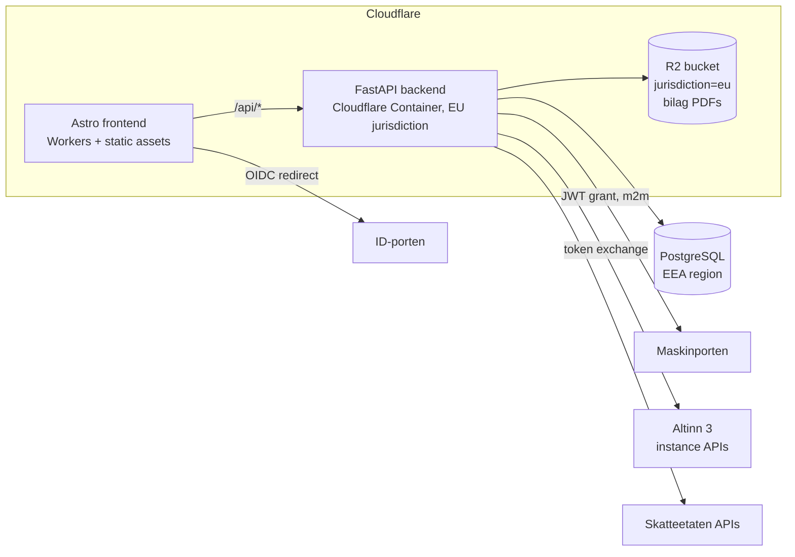

# Architecture

> Facts below about Skatteetaten/Digdir/Cloudflare were researched and
> verified against official sources in July 2026. Re-verify anything
> load-bearing before implementing against it — government APIs move.

## System overview



## Accounts, organizations and login

Myntos has its own accounts, entirely separate from the government auth below.
A user signs in with **email and password** or with **Google** ("logg inn med
Gmail"); both land in the same account model.

### The organization is the tenant

```
Organization ─┬─ OrganizationMembership ── User ─┬─ password hash
   (billing)  │        (role)                    └─ UserIdentity (google)
              └─ Company (orgnr) ── ledger, bilag, MVA
```

- **`Organization`** is the Myntos account: it owns the members and it is what a
  subscription will attach to. A plan bought by one person therefore covers
  every colleague invited into it and every company kept under it — adding a
  user never multiplies the bill.
- **`Company`** is a bookkeeping-obligated entity with an orgnr. A regnskapsfører
  is one organization with many companies; a single AS is one organization with
  one. `orgnr` is unique *per organization*, not globally, so two accounting
  firms can each keep a set of books for the same client.
- **`OrganizationMembership`** carries the role. Roles are `owner`, `admin`,
  `member`, `viewer`, and the role → permission table lives in exactly one place
  (`domain/identity/access.py`) — no endpoint compares roles itself. Two rules
  are load-bearing: only an owner may create, demote or remove an owner (else
  the owner/admin split is decorative), and the last owner may not leave (an
  organization without one cannot be billed, staffed or deleted).
- Colleagues join through an **invitation** addressed to an email address. Only
  the token's hash is stored, it is single-use, and the accepting account's
  address must match the invited one — a forwarded link is not a ticket in.

### Where the organization's name comes from

Signup does not ask for one. People who are not accountants do not think of
themselves as having an "organization", and a required field there is a wall in
front of the first screen. So signup invents `"Kari Nordmann (privat)"` and sets
**`organization.name_is_placeholder`**.

That flag is stored rather than recomputed, because it cannot be recomputed: the
user may have changed their own name since, and comparing the current name
against the generated string would guess wrong for exactly those people.

The rule it buys is one line in `POST /api/v1/companies`
(`identity.service.adopt_name_if_placeholder`): **setting up the first set of
books renames a placeholder organization to the company's name, and clears the
flag.** The company name came from Enhetsregisteret, so it is both correct and
the name its owner would have typed — and leaving "Kari Nordmann (privat)" in the
header next to it reads as though the lookup had failed. Two limits keep it from
being magic: only a placeholder is ever taken over, and it happens at most once,
so a regnskapsfører adding their second client company does not get the firm
renamed out from under them. `PATCH /api/v1/organizations/{id}` clears the flag
too — a name someone typed is never overwritten.

Both `GET /auth/me` (as `organization_name_is_placeholder`) and the organization
endpoints (as `name_is_placeholder`) expose it, so the frontend can offer a
rename instead of presenting a made-up name as settled fact.

### Credentials and sessions

- The **password hash** (Argon2id) sits on the user; each **federated login** is
  a separate `user_identity` row. One person can hold both, so someone who
  signed up with a password and later clicks "log in with Google" keeps the same
  account, memberships and audit trail instead of forking a second one.
- A federated identity is only linked to an **existing** account when the
  provider asserts the email is **verified**. Matching on the address alone is
  the classic federated-login account-takeover — Microsoft's nOAuth advisory is
  the same bug — and refusing is the whole defence. A *new* account is created
  either way, because there is nobody to take over and refusing would block
  every Microsoft user (see below); it is simply recorded as unverified.
- **Sessions are server-side and revocable**: an opaque 256-bit token in an
  `httpOnly; Secure; SameSite=Lax` cookie, stored only as a SHA-256 digest. A
  stateless JWT was rejected because "log me out everywhere" and "lock this
  compromised account" have to take effect immediately on a system holding
  accounting records. Non-browser clients can ask for the same token as a bearer
  token instead.
- Cookie-authenticated **writes** additionally require an `Origin` in the CORS
  allow-list, as a second layer behind `SameSite`. Bearer-authenticated requests
  skip the check — the header has to be attached deliberately.

Not yet built, and deliberately: no email delivery (so verification mails and
invitation mails do not go out — the invite link is returned to the inviter
once, to pass on) and no password reset.

### Federated providers

One OIDC implementation (`auth/oidc/client.py`), several providers as data
(`auth/oidc/providers.py`): authorization-code flow with PKCE, `state` and
`nonce` in an `oauth_login_attempt` row, and full ID-token verification.
`/auth/{provider}/start` and `/auth/{provider}/callback` are generic, and
`/auth/providers` lists only what this deployment has credentials for — so a
button can never lead to a 503. Adding a provider needs no migration:
`user_identity.provider` is a VARCHAR precisely so the list can grow.

Three things genuinely differ between providers, and each has bitten real
systems:

| | Google | Microsoft (Entra ID) | Vipps |
| --- | --- | --- | --- |
| Issuer check | two accepted spellings | discovery returns a `{tenantid}` **template**, resolved against the token's own `tid` (validated as a GUID first) | plain equality |
| Email verified | `email_verified` | **not sent** — `xms_edov` optional claim instead | `email_verified` |
| Email claim | `email` | `email`, falling back to `preferred_username` | `email` |

The Microsoft row is the interesting one. Entra ID never emits
`email_verified`; the equivalent is `xms_edov` ("email domain owner verified"),
an optional claim that has to be switched on in the app registration and that
exists as Microsoft's own remediation for nOAuth. Absence therefore reads as
*unverified* — which stops a Microsoft login from being attached to an existing
Myntos account, without preventing a new one. `MICROSOFT_TENANT` is an
authorization boundary rather than a formality: `common` lets any Microsoft
tenant in the world start a sign-in.

Vipps needs a merchant agreement rather than a self-service app registration,
and its discovery URL in `.env.example` has **not** been verified against
current Vipps documentation — check it before enabling. It is a configuration
value, so correcting it is not a code change.

## The cash-flow register

The first thing a user can actually do. One payment in or out per entry, and
three questions: how much moved, when, and **what it was for**.

That third one is the whole design. A bank statement cannot tell a deductible
cost from a private withdrawal, and the difference is exactly what the
næringsspesifikasjon and the MVA-melding are built from. So the register asks,
with a catalogue of types (`domain/ledger/cashflow.py`) that each carry:

- the **account** the amount books to — and through that account, the per-year
  `GroupingCategory`/`GroupingCode` that becomes a skattemelding post;
- the **default VAT code**, which is what the MVA-melding aggregates over; and
- a **note stating the assumption**, because the default is a default. Rented
  premises carry VAT only if the landlord is voluntarily registered, a car
  expense is deductible for a van and not for a passenger car. The user can
  override the code, and the note is shown next to the choice. Guessing
  silently is what turns a bookkeeping tool into a liability.

Mechanically an entry is an ordinary voucher, not a parallel structure:

```
Salg 1 250 kr, 25 % mva                 Kontorrekvisita 625 kr, 25 % mva
  1920 Bank        D 1250                 6800 Kontorrekvisita  D  500  ← mva-kode her
  3000 Salg        K 1000  ← mva-kode her 2710 Inngående mva    D  125
  2700 Utgående mva K  250                1920 Bank             K  625
```

- The user enters the **gross** amount, because that is the number on the bank
  statement. `posting.split_gross` derives the net as `gross / (1 + rate)` and
  the VAT as `gross - net` — never `net * rate`, which rounds the two halves
  independently and leaves vouchers an øre out of balance.
- `TaxInformation` goes on the **basis** line, never the VAT-account line
  (`posting.set_tax_information` is the single writer, so the two callers
  cannot drift).
- Entries are **posted immediately** — the money has moved, there is nothing
  provisional about it — and are therefore immutable. A mistake is undone by
  reversal, and `gl_transaction.reverses_transaction_pk` records which entry
  was undone so an auditor can see both, and so nothing is reversed twice.
- Creating a company **seeds** a starter kontoplan, the VAT codes with
  date-effective rates, the first financial year and its per-year account
  groupings. Without that, a new user's first action would be building a chart
  of accounts. Dates before the first financial year are refused: the seeded
  rates are only claimed to hold from then, and posting earlier would snapshot
  an invented rate onto the entry.

**Who** the payment was with is a separate field: `Party`, SAF-T's `Customers`
and `Suppliers`. It is optional, because most payments have no counterparty
worth registering and demanding one makes people invent placeholder suppliers.
Each party settles against a balance account derived from its type
(kundefordringer or leverandørgjeld — SAF-T's `BalanceAccountStructure`), and
the reference goes on the **basis** line, like the tax information, because
that is the line describing the trade. The party number and type are fixed once
created: posted vouchers point at them, and SAF-T exports them per financial
year, so changing either would rewrite what past filings said.

**Bilag documents** attach to a posted voucher (`bilag_attachment` +
`myntos.storage`). PDF only, verified by magic number rather than by the
uploader's `Content-Type`; the storage key is generated and never derived from
the filename; the SHA-256 is stored so the file handed to an auditor can be
proven to be the one uploaded. The archive is **append-only** — there is no
delete endpoint, because bokføringsloven § 13 requires primary documentation to
stay available for five years after the financial year ends.

None of this is a shortcut around the exporters. The register writes the same
tables the SAF-T export and the MVA-melding will read, which is why it was
worth building on the ledger rather than beside it.

### Document storage

Two backends behind one `DocumentStorage` protocol, and one key format shared
by both, so a document moved between them keeps its key. The key is generated
(`yyyy/<uuid>.pdf`) and validated on the way back out: nothing the uploader
supplies takes part in building a path, and a key that cannot express a
traversal cannot be talked into one.

- **local** — filesystem, development only. A Cloudflare Container's disk is
  ephemeral.
- **r2** — Cloudflare R2 over its S3 API, signed with SigV4. The
  **jurisdiction is part of the endpoint hostname**
  (`<account>.eu.r2.cloudflarestorage.com`), fixed when the bucket is created
  and unchangeable afterwards, so pointing at the plain hostname does not fail
  over — it silently writes accounting records outside the EEA.
  `R2_JURISDICTION` therefore defaults to `eu` and has to be turned off
  deliberately. Missing or blank credentials fail at startup rather than at the
  first upload.

SigV4 is implemented in `storage/sigv4.py` against httpx rather than pulling in
boto3: botocore is tens of megabytes of vendored service definitions and a
synchronous transport, for about two hundred lines of use. The algorithm is
published and fixed, the implementation is verified against AWS's own
`get-vanilla` test vector, and the failure mode is benign — a signing mistake
means R2 answers 403 on the first request rather than corrupting anything.

## Frontend

Astro, prerendered, no framework. The API lives on its own origin, so every
page talks to it with `fetch(..., {credentials: 'include'})`; the session cookie
is httpOnly, so no script on the page can read it — an XSS bug cannot exfiltrate
a login.

The front page is two pages in one file. What ships in the HTML is the
signed-out one: that is what a search engine indexes and what a visitor without
JavaScript sees. `data-auth` on `<html>` decides which half is displayed, and it
starts at `"ut"`. To avoid a returning user seeing the marketing page flash
before their dashboard, an inline script in `<head>` reads a **hint** from
`localStorage` before first paint. The hint is not a credential and grants
nothing — `/auth/me` answers a moment later and overrules it either way.

| Page | Purpose |
| --- | --- |
| `/` | Marketing when signed out; overview, totals and recent entries when signed in |
| `/kontantstrom/` | The register: entry form, listing, reversal, PDF upload |
| `/faktura/` | Salgsdokument: line editor, a review step that shows the § 5-1 findings before anything is issued, kreditnota, PDF and EHF download |
| `/logg-inn/`, `/registrer/` | Password and Google sign-in; the Google button hides itself when the deployment has no Google client |
| `/invitasjon/` | Accepts an invitation token, sending the recipient to sign in first if needed |
| `/organisasjon/` | Name, members, roles and invitations for the organization — and **Selskapet**, the only place the company's own details are edited: kontonummer, VAT registration, Foretaksregisteret, address |

`/faktura/` is three cards and one of them at a time — the form, the review,
and what came out. Issuing is irreversible, so the step between the form and a
number in an unbroken series is something you **read**: it shows the fields the
buyer is about to receive, the account the invoice is paid to, and every § 5-1
finding, with the issue button disabled while any of them blocks. There is no
separate "save draft" button; submitting the form saves the draft, because the
checks run against the *stored* document. Once issued, the PDF and the EHF are
linked from that same card rather than only from the table below.

Conventions the pages rely on — and the traps that go with them — are in
[docs/frontend-conventions.md](frontend-conventions.md). The load-bearing one:
**visibility is the `hidden` attribute**, and `BaseLayout.astro` has to declare
`[hidden] { display: none !important }` for that to hold, because the browser's
own rule for `hidden` is user-agent origin and loses to any author `display`.

`PUBLIC_API_BASE_URL` is inlined at build time (`frontend/.env.example`). In
production the API must sit on the same registrable domain as the site (e.g.
`api.myntos.no` beside `myntos.no`) so the `SameSite=Lax` cookie is sent, with
a matching `SESSION_COOKIE_DOMAIN` and the site's origin in `CORS_ORIGINS`.

## The two auth planes (this is the part everyone gets wrong)

Skatteetaten's policy as of 2026:

| Operation | Auth required |
| --- | --- |
| Retrieve current skattemelding, PDFs, information APIs | **Maskinporten** (machine-to-machine JWT grant) |
| **Validate + submit** MVA-melding and skattemelding | **ID-porten** (a real person logs in, OIDC authorization-code) |

A fully headless "accounting robot" that submits filings without a human is
**not permitted** — this is a policy wall, not a technical one. Both token
types are exchanged for an **Altinn token**
(`platform.altinn.no/authentication/api/v1/exchange/{maskinporten|id-porten}`)
before calling the Altinn 3 instance APIs that carry the actual submission.

Consequences for the code:

- `auth/maskinporten/` — m2m token provider (JWT grant, RFC 7523). The
  protocol details and sharp edges live in
  [integrations/maskinporten.md](integrations/maskinporten.md).
- `auth/idporten/` — end-user OIDC flow: frontend redirect → backend
  callback → token exchange. Needed before any submission milestone.
- The domain layer never sees tokens; integrations receive a
  `TokenProvider` and handle exchange internally.

## Backend layout (`backend/src/myntos/`)

| Package | Responsibility | Depends on |
| --- | --- | --- |
| `api` | HTTP endpoints, versioned (`/api/v1`) | domain, core |
| `core` | Settings (pydantic-settings, env-driven), security middleware, clock | — |
| `auth` | Myntos login (passwords, tokens, sessions, Google OIDC) **and** Maskinporten + ID-porten token acquisition | core, domain.identity |
| `domain` | Ledger (incl. the cash-flow register), bilag, mva, identity (accounts/organizations) — business logic | core, db |
| `integrations` | Skatteetaten/Altinn/Brreg/Løynd clients (translate domain ⇄ external APIs) | auth, core |
| `saft` | SAF-T Financial export (serializer over the ledger) | domain |
| `db` | SQLAlchemy base/session; Alembic in `backend/migrations/` | core |
| `storage` | Bilag document storage (local dev / R2 prod) | core |

Dependency rule: **`domain` imports nothing from `api`, `integrations` or
`storage`.** Integration code contains no business logic.

### KI: anywhere in the product, one provider only

**The rule: Myntos may use AI wherever it earns its place — but only through
[Løynd](https://loynd.no).** No other model provider, no other endpoint, no
"just for this one feature". A new AI feature needs no architectural argument
about *whether* to use a model; it needs `integrations/loynd.py` and nothing
else. If a task cannot be done through Løynd, it is not done with AI.

That is a single decision doing several jobs at once:

- **Data residency stays answerable.** Løynd's inference servers are in Norway
  and it retains nothing, so anything Myntos sends a model is covered by one
  sentence in the personvernerklæring instead of a transfer basis, an SCC annex
  and a DPIA per provider.
- **One place to audit.** Every prompt this product will ever send leaves
  through one module. Adding a second provider would mean the honest answer to
  "where does my bookkeeping go?" is a list that grows.
- **One place to switch.** The API is OpenAI-shaped and `LOYND_BASE_URL` is
  configuration, so a self-hosted model is a deployment choice, not a rewrite.

Two constraints come with the permission, and they are not negotiable per
feature: a model's answer is **never** posted to the ledger without a person
confirming it, and a model is never asked for something the software can
determine itself. What the second one means in practice is below.

### Where a model is allowed to answer

Uploading a bilag fills the entry form in. Almost all of that is deterministic:
`domain/bilag/text.py` pulls the PDF's text layer out with pypdf, and
`domain/bilag/interpretation.py` reads the date, the total, the VAT, the
organisasjonsnummer and the counterparty **off the page**. Those are printed
facts, and a language model that got one of them subtly wrong would be both
invisible and expensive.

So exactly one question is put to a model there: *which category is this?* — the
one thing an invoice never states, and the thing that decides the account and
through it the næringsspesifikasjon post. `domain/bilag/classification.py`
renders the cash-flow catalogue as a **numbered menu** and accepts one number
back; anything else is discarded and the keyword reading stands. The menu is
narrowed to one direction when a registered party has already settled that
question.

The second use is `domain/faktura/drafting.py`, behind
`POST /companies/{id}/faktura/linjeforslag`: a sentence describing a sale becomes
invoice lines. The same rule holds in a different shape — the model **restates
what the user already typed** and computes nothing. Quantity and unit price come
out of the user's own sentence; every amount on the document is derived from them
by `faktura/service.py` exactly as it would be for a hand-typed line. The VAT
treatment is again a numbered menu, narrowed to the zero option when the company
is outside Merverdiavgiftsregisteret, so a proposal that charges VAT unlawfully
(mval. § 15-14) is not on offer rather than caught later.

The menu is worth copying for the next feature: a model that answers with a
number from a list we wrote cannot invent an account, a rate or an amount, and a
small model is enough for it. Reach for free text only when the answer genuinely
is free text — and where the answer has to carry more than one field, give it a
fixed column format and discard every row that does not fit it, rather than
guessing which field is missing.

Four properties follow, and they are the reason for the shape:

- **Layering holds.** `classify()` and `draft_lines()` each take an `ask`
  callable, so the domain still imports nothing from `integrations`; the endpoint
  passes `integrations/loynd.py` and catches its errors.
- **Optional by construction.** No `LOYND_KEY`, no request — the entry form is
  filled in as far as the text allows, and the invoice form leaves the box out
  entirely (`FakturaCatalogueResponse.ai_available`).
- **Attributable.** The bilag suggestion carries `type_source` (`dokument` /
  `ki`); a proposed invoice line is badged *Foreslått av KI* in the form. A
  reading and a guess must not look alike to the person who signs for it.
- **Nothing irreversible.** A proposal reaches a draft, never the ledger. Issuing
  still runs the full § 5-1 check on a document a person saved.

Whatever gets built next inherits a promise already made in public:
[/ki](https://myntos.no/ki/) and `frontend/src/pages/personvern.astro` tell the
user where AI is used, what leaves the building and who runs the model. A new
use those pages do not describe is a bug in the pages, not an undocumented
feature. `MAX_DOCUMENT_CHARS` in `classification.py` and `MAX_REQUEST_CHARS` in
`drafting.py` are the same promise in code: send the model what the question
needs, and no more. Note what is *not* sent with a line proposal — not the
buyer, not the company, not the ledger. The question does not need them.

### Data-model constraints (legal, non-negotiable)

- **SAF-T-aligned from day one**: since SAF-T v1.30 the old standard-kontoplan
  account mapping is obsolete — every GL account carries a **per-financial-year
  `GroupingCategory`/`GroupingCode` mapping** (næringsspesifikasjon post
  numbers, year-versioned code lists), and every internal VAT code maps to a
  `StandardTaxCode`. The export is version-parameterized: v1.30 (usable until
  2026-12-31) and v1.40 (mandatory for periods from 2027-01-01). The SAF-T
  export is then a projection, not a translation.
- **One shared VAT-code dimension** feeds both the SAF-T export and the
  MVA-melding (the melding is an aggregation `GROUP BY (mvaKode,
  spesifikasjon, sats)` per period).
- **Posted entries are immutable** — corrections are reversals
  (bokføringsloven traceability).
- **VAT rates are date-effective reference data**, never constants: rates
  change mid-year (e.g. water/wastewater 25% → 15% on 2025-07-01, on the
  same SAF-T code as food).
- **Money is exact decimals.** Floating point never touches amounts.

## Deployment (decided July 2026)

- **Frontend:** Astro 7 + `@astrojs/cloudflare` v14 on **Cloudflare Workers**
  with static assets. Pages is in maintenance mode; the adapter no longer
  supports it.
- **Backend:** FastAPI in a **Cloudflare Container** (GA since 2026-04),
  pinned `jurisdiction: "eu"`. Python Workers were rejected: still beta and —
  decisively — no native TCP sockets, so SQLAlchemy/asyncpg cannot reach
  Postgres. The container image (`backend/Dockerfile`) is plain Docker, so
  the backend can move to any EEA host unchanged if a regulator or customer
  ever requires it. Containers are stateless: disk is ephemeral, instances
  sleep — all state lives in Postgres and R2.
- **Database:** managed PostgreSQL in an **EEA region** (e.g. Supabase
  Stockholm `eu-north-1`, Neon Frankfurt; Aiven (EEA-owned) is the hedge
  against US CLOUD-Act concerns). Connect directly with asyncpg — Hyperdrive
  is JS-Workers-only and its default query caching is dangerous for ledger
  reads anyway.
- **Documents:** R2 bucket created with **`jurisdiction=eu`** (immutable
  after creation — create it right the first time; location *hints* are not
  a compliance mechanism).

### Why EEA hosting is legal (and what the product must do about it)

Since 2025-01-29, bokføringsforskriften **§ 7-5** allows electronic
accounting records to be kept in any **EEA state, the UK or Switzerland**
without dispensation, provided the bookkeeping-obligated entity:

1. **notifies skattekontoret in writing** — what is stored abroad, where, and
   how authorities get access; and
2. keeps records **readable and printable from a terminal in Norway** for the
   whole retention period (5 years for primary documentation,
   bokføringsloven § 13).

Both duties fall on **each user**, not on Myntos — so the product must
(a) generate the § 7-5 notification letter for the user, and (b) guarantee
readable/printable access (SAF-T export + PDF viewer). A full-data
repatriation path (Postgres dump + R2 bulk export) must exist for users
ordered to store in Norway after a compliance breach.

## Security model

- **Secrets:** only via environment / injected secrets. Maskinporten private
  keys are per-installation JWKs (Digdir's recommendation), rotated at least
  yearly (registered keys expire after 1 year), never shared across
  installations, never in the repo. `.gitignore` + gitleaks (pre-commit and
  CI) enforce the repo side.
- **Least privilege:** one Maskinporten client per deployment; narrow scopes;
  separate clients per API rather than one client with everything.
- **Transport/API hardening:** security headers middleware on every response
  (`core/security.py`), API docs disabled in production, explicit CORS
  allow-list, `Cache-Control: no-store` on API responses.
- **Supply chain:** locked dependencies (uv.lock, pnpm-lock.yaml), Dependabot
  (uv ecosystem supported since 2025), GitHub Actions pinned to commit SHAs,
  secret scanning in CI.
- **Tokens:** government access tokens are cached in memory only, never logged,
  never persisted. Application credentials are never stored in usable form:
  passwords as Argon2id hashes, session and invitation tokens as SHA-256 digests
  of 256-bit random values.
- **Passwords:** Argon2id at argon2-cffi defaults (t=3, m=64 MiB, p=4 — above
  the OWASP 19 MiB floor); parameters live in the hash, so raising them
  re-hashes users on their next sign-in. Policy is length-only (≥12), and login
  failures throttle per account. Broad source-based rate limiting is expected at
  the Cloudflare edge, not in the application.
