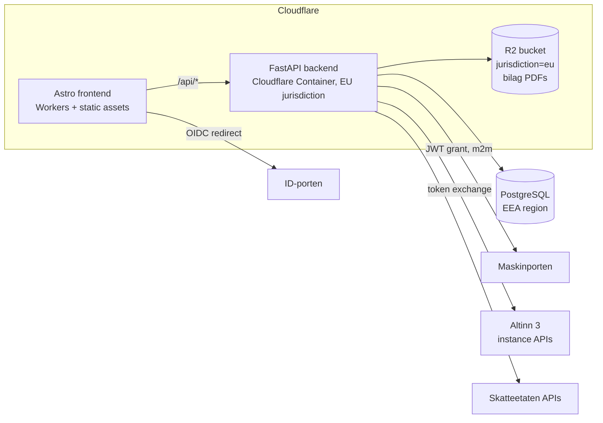

# Architecture

> Facts below about Skatteetaten/Digdir/Cloudflare were researched and
> verified against official sources in July 2026. Re-verify anything
> load-bearing before implementing against it — government APIs move.

## System overview

## The two auth planes (this is the part everyone gets wrong)

Skatteetaten's policy as of 2026:

| Operation | Auth required |
| --- | --- |
| Retrieve current skattemelding, PDFs, information APIs | **Maskinporten** (machine-to-machine JWT grant) |
| **Validate + submit** MVA-melding and skattemelding | **ID-porten** (a real person logs in, OIDC authorization-code) |

A fully headless "accounting robot" that submits filings without a human is
**not permitted** — this is a policy wall, not a technical one. Both token
types are exchanged for an **Altinn token**
(`platform.altinn.no/authentication/api/v1/exchange/{maskinporten|id-porten}`)
before calling the Altinn 3 instance APIs that carry the actual submission.

Consequences for the code:

- `auth/maskinporten/` — m2m token provider (JWT grant, RFC 7523). The
  protocol details and sharp edges live in
  [integrations/maskinporten.md](integrations/maskinporten.md).
- `auth/idporten/` — end-user OIDC flow: frontend redirect → backend
  callback → token exchange. Needed before any submission milestone.
- The domain layer never sees tokens; integrations receive a
  `TokenProvider` and handle exchange internally.

## Backend layout (`backend/src/myntos/`)

| Package | Responsibility | Depends on |
| --- | --- | --- |
| `api` | HTTP endpoints, versioned (`/api/v1`) | domain, core |
| `core` | Settings (pydantic-settings, env-driven), security middleware | — |
| `auth` | Maskinporten + ID-porten token acquisition | core |
| `domain` | Ledger, bilag, mva — pure business logic | core |
| `integrations` | Skatteetaten/Altinn clients (translate domain ⇄ external APIs) | auth, core |
| `saft` | SAF-T Financial export (serializer over the ledger) | domain |
| `db` | SQLAlchemy base/session; Alembic in `backend/migrations/` | core |
| `storage` | Bilag document storage (local dev / R2 prod) | core |

Dependency rule: **`domain` imports nothing from `api`, `integrations` or
`storage`.** Integration code contains no business logic.

### Data-model constraints (legal, non-negotiable)

- **SAF-T-aligned from day one**: since SAF-T v1.30 the old standard-kontoplan
  account mapping is obsolete — every GL account carries a **per-financial-year
  `GroupingCategory`/`GroupingCode` mapping** (næringsspesifikasjon post
  numbers, year-versioned code lists), and every internal VAT code maps to a
  `StandardTaxCode`. The export is version-parameterized: v1.30 (usable until
  2026-12-31) and v1.40 (mandatory for periods from 2027-01-01). The SAF-T
  export is then a projection, not a translation.
- **One shared VAT-code dimension** feeds both the SAF-T export and the
  MVA-melding (the melding is an aggregation `GROUP BY (mvaKode,
  spesifikasjon, sats)` per period).
- **Posted entries are immutable** — corrections are reversals
  (bokføringsloven traceability).
- **VAT rates are date-effective reference data**, never constants: rates
  change mid-year (e.g. water/wastewater 25% → 15% on 2025-07-01, on the
  same SAF-T code as food).
- **Money is exact decimals.** Floating point never touches amounts.

## Deployment (decided July 2026)

- **Frontend:** Astro 7 + `@astrojs/cloudflare` v14 on **Cloudflare Workers**
  with static assets. Pages is in maintenance mode; the adapter no longer
  supports it.
- **Backend:** FastAPI in a **Cloudflare Container** (GA since 2026-04),
  pinned `jurisdiction: "eu"`. Python Workers were rejected: still beta and —
  decisively — no native TCP sockets, so SQLAlchemy/asyncpg cannot reach
  Postgres. The container image (`backend/Dockerfile`) is plain Docker, so
  the backend can move to any EEA host unchanged if a regulator or customer
  ever requires it. Containers are stateless: disk is ephemeral, instances
  sleep — all state lives in Postgres and R2.
- **Database:** managed PostgreSQL in an **EEA region** (e.g. Supabase
  Stockholm `eu-north-1`, Neon Frankfurt; Aiven (EEA-owned) is the hedge
  against US CLOUD-Act concerns). Connect directly with asyncpg — Hyperdrive
  is JS-Workers-only and its default query caching is dangerous for ledger
  reads anyway.
- **Documents:** R2 bucket created with **`jurisdiction=eu`** (immutable
  after creation — create it right the first time; location *hints* are not
  a compliance mechanism).

### Why EEA hosting is legal (and what the product must do about it)

Since 2025-01-29, bokføringsforskriften **§ 7-5** allows electronic
accounting records to be kept in any **EEA state, the UK or Switzerland**
without dispensation, provided the bookkeeping-obligated entity:

1. **notifies skattekontoret in writing** — what is stored abroad, where, and
   how authorities get access; and
2. keeps records **readable and printable from a terminal in Norway** for the
   whole retention period (5 years for primary documentation,
   bokføringsloven § 13).

Both duties fall on **each user**, not on Myntos — so the product must
(a) generate the § 7-5 notification letter for the user, and (b) guarantee
readable/printable access (SAF-T export + PDF viewer). A full-data
repatriation path (Postgres dump + R2 bulk export) must exist for users
ordered to store in Norway after a compliance breach.

## Security model

- **Secrets:** only via environment / injected secrets. Maskinporten private
  keys are per-installation JWKs (Digdir's recommendation), rotated at least
  yearly (registered keys expire after 1 year), never shared across
  installations, never in the repo. `.gitignore` + gitleaks (pre-commit and
  CI) enforce the repo side.
- **Least privilege:** one Maskinporten client per deployment; narrow scopes;
  separate clients per API rather than one client with everything.
- **Transport/API hardening:** security headers middleware on every response
  (`core/security.py`), API docs disabled in production, explicit CORS
  allow-list, `Cache-Control: no-store` on API responses.
- **Supply chain:** locked dependencies (uv.lock, pnpm-lock.yaml), Dependabot
  (uv ecosystem supported since 2025), GitHub Actions pinned to commit SHAs,
  secret scanning in CI.
- **Tokens:** cached in memory only, never logged, never persisted.
